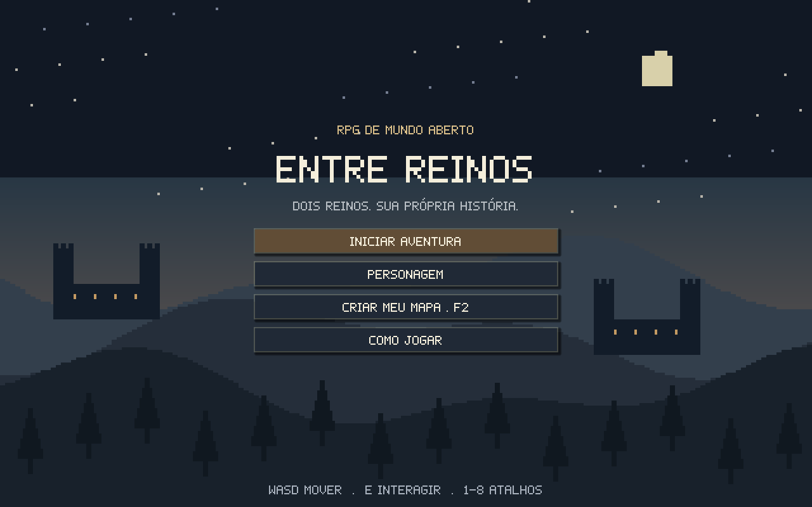
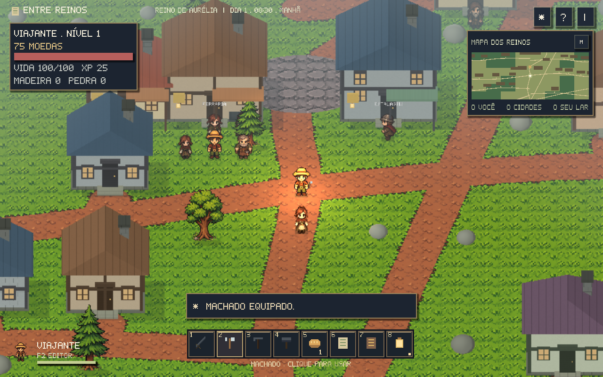
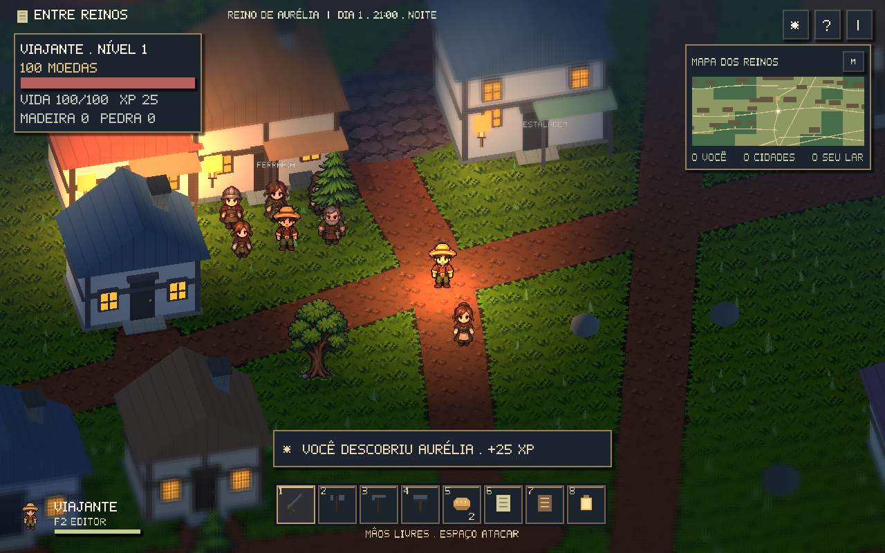
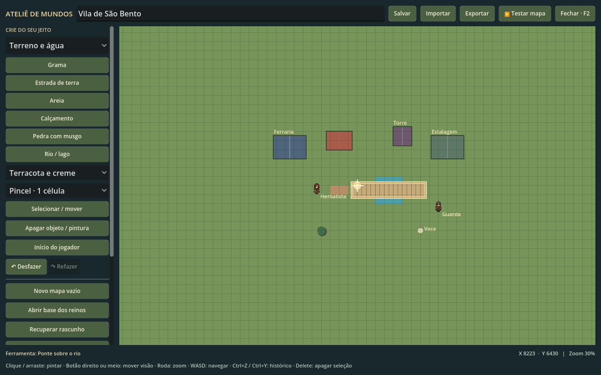
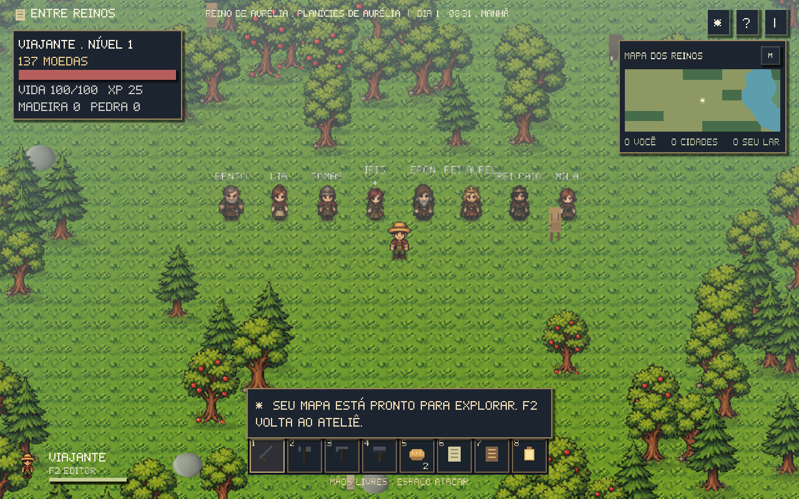
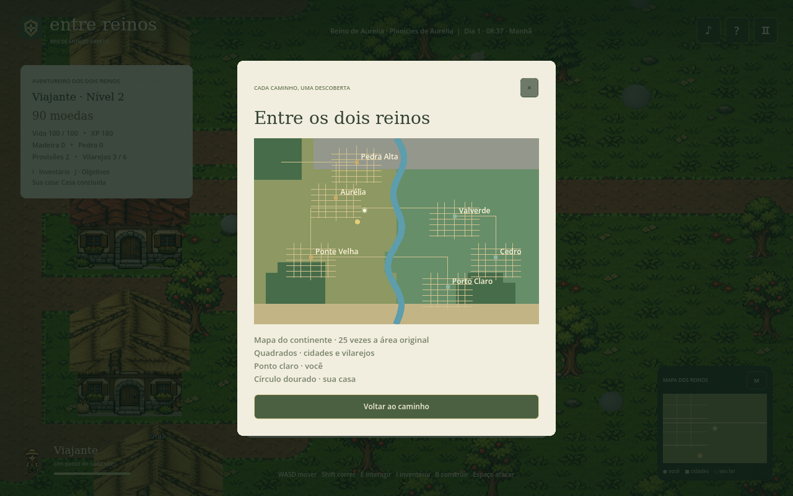
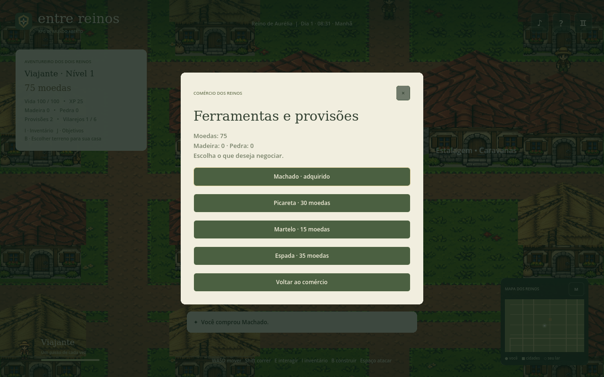
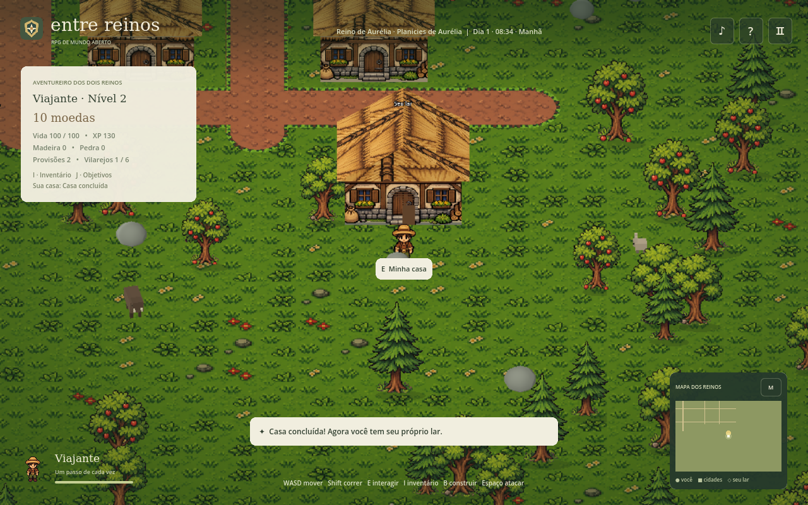
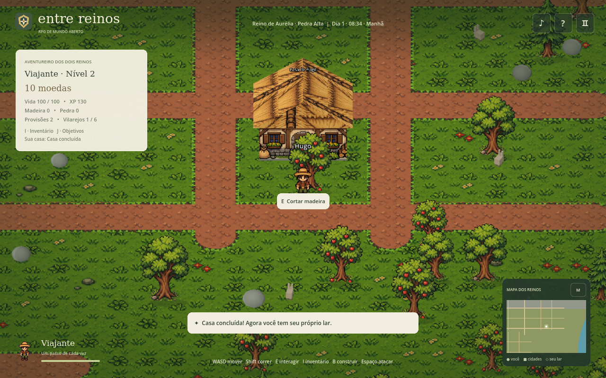
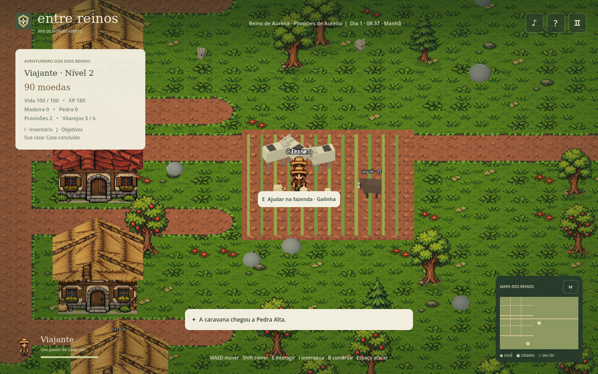

# Entre Reinos · Godot 4

Um **RPG de mundo aberto 2.5D para Windows e Linux**. Personagens em pixel art vivem em cidades, vilarejos e campos com cenário 3D. Explore, negocie, compre ferramentas, enfrente animais e construa sua casa.

[Baixar o jogo pronto](downloads/README.md)



O continente agora combina ruas curvas, lotes irregulares, bosques em grupos e transições suaves entre campos, pedreiras e costa. O rio varia de largura e direção. A geração usa uma semente fixa para manter o mundo consistente ao salvar e carregar.



Personagens em pixel art continuam em um cenário 3D com câmera inclinada: **2.5D**. O sol acompanha o horário, a distância ganha neblina e, à noite, postes, janelas e a lanterna criam pontos de luz. Título, diálogos, inventário, mapa e hotbar usam uma fonte bitmap própria e molduras no estilo de RPG de PC.

O visual agora tem **billboards que preservam as proporções**, sombras da silhueta dos personagens no chão, grama 3D que se curva à passagem e reflexos da cena na água. Casas e árvores que encobrem o personagem ficam parcialmente transparentes. Chuva, neblina e vento variam ao longo dos dias; nuvens alteram a iluminação, tochas tremulam e janelas acendem à noite.

Em **Esc → Gráficos: HD-2D**, ative desfoque por faixa de foco, bloom e sombras do sol. O **modo leve** permanece como padrão. Use **Q/R** ou arraste com o botão do meio para girar até 35°; **Ctrl+roda / PgUp / PgDn** ajusta o zoom; **Home** centraliza. A roda sem Ctrl continua selecionando itens. Câmera e preferência de clima são salvas.

[Guia do visual e da câmera](docs/visual-hd2d.md)



## Crie seu próprio mapa

Pressione **F2** para abrir o **Ateliê de Mundos**, incluído no jogo pronto. Comece com um mapa vazio ou edite a base dos reinos. Pinte terreno e rios; coloque casas, pontes, árvores, animais e moradores; defina os pontos de casa, trabalho e passeio dos NPCs. Use zoom, arraste a visão, desfaça/refaça e clique em **Testar mapa** para jogar.

**Salvar** guarda o rascunho. **Exportar / Importar** permite compartilhar mapas em JSON. Cada mundo mantém sua aventura separada; você pode voltar ao continente original e recuperar seu progresso.

[Guia do editor](docs/editor-de-mapas.md) · [Mapa de exemplo para importar](docs/mapa-exemplo.json)





Os NPCs agora misturam **nove bases visuais diferentes**, incluindo os oito personagens de `abc.zip`. As construções usam **seis paletas**, telhados e detalhes variados. Novos shaders trabalham a água, os materiais das casas e as cores do cenário; os efeitos podem ser desligados no menu de pausa.

## O novo mundo

- **16.000 × 12.800 unidades**, 250 × 200 tiles: cinco vezes maior em cada eixo e **25 vezes a área** do mapa anterior.
- Dois reinos com capitais maiores: **Aurélia e Valverde**.
- Quatro vilarejos: **Pedra Alta, Ponte Velha, Porto Claro e Cedro**.
- **126 construções** nas capitais e povoados, com ruas, ferrarias, estalagens, castelos e fazendas.
- **44 NPCs**, com trabalho, comércio, encontros e descanso em horários próprios.
- Planícies, campos, pedreiras do norte, costa, rio com quatro pontes e pequenos bosques regionais.

A proposta principal passou a ser criar sua vida entre os reinos. As antigas sementes permanecem como uma atividade opcional do vale noroeste.



## Ferramentas, comércio e experiência

Comece com 100 moedas e duas provisões. As ferrarias vendem machado (25), picareta (30), martelo (15), espada (35) e provisões (5).

Use **E**, ou equipe machado/picareta na hotbar e clique, perto do recurso. Cada golpe gasta energia e reduz sua vida. Há trepidação, poeira, fragmentos, número de dano, pequeno movimento de câmera e som de impacto (ative **Som** na interface).

Árvores tremem, caem e deixam um toco. Madeira, pedra e minérios saltam com física leve e são atraídos ao jogador quando ele se aproxima. O inventário só recebe o que foi recolhido do chão. Vida parcial, drops pendentes, ferramentas e habilidades ficam no save; trocar de região não duplica materiais.

| Recurso | Vida | Ferramenta mínima | Regenera após |
| --- | ---: | --- | ---: |
| Árvore | 36 | Machado de madeira | 3 dias |
| Rocha | 40 | Picareta de madeira | 5 dias |
| Rocha dura | 70 | Picareta de pedra | 5 dias |
| Cobre | 64 | Picareta de pedra | 5 dias |
| Ferro | 80 | Picareta de pedra | 7 dias |
| Basalto compacto | 100 | Picareta de ferro | 7 dias |

Os depósitos especiais aparecem nas montanhas e também podem ser colocados em **F2 → Natureza**. Árvores entregam 5–7 madeira; rochas comuns, 4–6 pedra. Cada tipo tem sua própria tabela de drops em [ResourceRules](game/resource_rules.gd), incluindo chances de materiais extras.

Melhore machado e picareta na ferraria: **pedra** custa 40 moedas, 5 madeira e 10 pedra; **ferro** custa 90 moedas e 6 ferro. Tiers maiores causam mais dano e gastam menos energia. As habilidades de **lenhador** e **mineiro** sobem com o uso e acrescentam bônus de dano e eficiência. O inventário mostra níveis, materiais e energia; a hotbar mostra o tier da ferramenta.

A regeneração acompanha os dias do relógio do jogo. Recursos não reaparecem em cima do jogador ou de uma construção; voltam quando o local está livre. Os tempos podem ser ajustados por tipo na mesma tabela de regras.

Venda materiais ou entregue encomendas de 15 madeira e oito pedra por 80 moedas e 40 XP, uma vez por dia em cada povoado. Explorar, recolher, construir e caçar dão experiência; o nível também aumenta o dano em combate.



## Sua casa

Pressione **B** para mostrar a prévia do terreno. A cor indica se o local está livre. Clique para reservar por 20 moedas; botão direito ou Esc cancela. A obra deve ficar perto do jogador e fora de ruas, rios, pedras, árvores, outras casas e terrenos reservados aos moradores.

Vá até a obra e use **E**, levando um martelo:

| Etapa | Madeira | Pedra |
| --- | ---: | ---: |
| Fundação | 15 | 10 |
| Paredes | 20 | 5 |
| Telhado | 15 | 5 |
| **Total** | **50** | **20** |

Cada etapa muda o modelo 3D e sua colisão. A casa pronta permite descansar e serve como ponto de retorno se o personagem for socorrido após perder a vida. Construção e descanso exigem estar junto ao terreno.



## Moradores que também compram e constroem

Cada NPC tem carteira e equipamento próprios. Moradores recebem salário e alguns compram a ferramenta de sua profissão quando visitam o comércio. Quatro construtores dos vilarejos têm um objetivo adicional:

1. Ir à ferraria e pagar por machado, picareta e martelo.
2. Reservar seu terreno com as próprias moedas.
3. Viajar até arvoredo e pedreira, recolher materiais e esgotar os mesmos recursos que o jogador pode usar.
4. Voltar à obra e pagar os custos de fundação, paredes e telhado.
5. Passar a usar a casa concluída em sua rotina de descanso.

Se o arvoredo ou a pedreira se esgotarem, o morador pode comprar material na loja. Converse e escolha **“Suas compras e sua casa”** para ver o dinheiro, as ferramentas, o objetivo e a etapa da construção. Os objetivos continuam sendo simulados longe da câmera; NPCs próximos usam a física e as animações de caminhada.

Os horários variam por morador e profissão. Lenhadores e mineiros alternam pontos de trabalho, vendem produção e compram ferramentas; o guarda patrulha a ponte; a comerciante viaja entre os reinos. Há pausas para refeições, encontros e retorno para casa. Os moradores evitam se amontoar, procuram desvios, tentam novamente quando uma passagem está bloqueada e fogem de javalis próximos. Fome, cansaço e atividades também são salvos.



## Animais, combate e rio

Vacas e galinhas vivem nas fazendas e fornecem provisões ao ajudar com **E**. A produção tem intervalo persistente, inclusive ao trocar de região ou carregar o save. Cervos, coelhos e javalis aparecem nos campos; animais tímidos fogem e javalis podem perseguir e atacar.

**Espaço** ataca animais próximos; com a espada selecionada, o clique esquerdo também ataca e causa mais dano. Caça entrega carne para venda e experiência. Provisões restauram vida; estalagens e sua casa oferecem descanso. Ao perder a vida, o personagem é socorrido, mantém o equipamento e perde cinco moedas.

É possível nadar de uma margem à outra e passar sob as pontes. Quem caminha usa rampas e corrimãos com colisão. Os moradores continuam seguindo rotas terrestres.



## Controles

| Tecla | Ação |
| --- | --- |
| WASD / setas | Mover e nadar |
| Shift | Correr / acelerar na água |
| E | Conversar, negociar, coletar e interagir |
| Espaço | Atacar |
| 1–4 | Equipar espada, machado, picareta ou martelo |
| 5 / 6 / 7 / 8 | Comer / mapa / diário / ligar ou desligar lanterna |
| Roda do mouse | Selecionar um espaço da hotbar |
| Clique esquerdo | Usar o item selecionado; clicar na hotbar seleciona/ativa o espaço |
| I | Inventário e provisões |
| J | Objetivos e registros |
| B | Escolher terreno / consultar sua obra |
| M | Mapa do continente |
| F2 | Criar / editar seu mapa |
| Q / R ou arrastar com botão do meio | Girar a câmera com limite |
| Ctrl + roda / PgUp / PgDn | Zoom da câmera |
| Home | Restaurar câmera |
| Esc | Cancelar prévia, fechar menu ou pausar |

Nas estalagens, caravanas de cinco moedas ligam os seis povoados. O mapa mostra cidades, posição do jogador e seu lar.

## Desempenho e salvamento

O mundo mantém **no máximo 25 regiões próximas de 512 × 512**. Terreno, árvores, rochas e animais são criados e liberados conforme o jogador se move. Cada terreno é desenhado uma vez para uma textura local; não há uma textura gigante do continente inteiro.

Árvores e rochas usam `MultiMesh`; animais usam uma instância de partes geométricas por modelo. O vento atua nos vértices, sombras de árvores ficam no terreno e personagens distantes deixam de executar física a cada quadro. A navegação considera cidades, rio, pontes e recursos das regiões ativas.

O modo **leve** usa 65% da resolução por eixo no cenário 3D; a interface fica na resolução integral. Em **Esc → Gráficos**, alterne para **HD-2D**, com resolução integral, foco suave, bloom e sombras do sol. Chuva e reflexos usam quantidades e resoluções reduzidas no modo leve; a reflexão só é atualizada perto da água. Em **Esc → Shaders**, ligue ou desligue os efeitos adicionais. Em **Esc → Clima**, escolha automático ou uma condição para explorar e testar seu mapa. As preferências são salvas.

O save versão 2 preserva posição, saúde, inventário, ferramentas, dinheiro, XP, exploração, recursos esgotados, casas, contas e equipamentos dos NPCs, vida dos recursos, drops no chão, energia, habilidades e tiers, produção das fazendas, encomendas e relógio. Saves antigos migram para a entrada de Aurélia e preservam aparência e a atividade antiga. O diretório de usuário `EntreFolhas` foi mantido para localizar esses dados.

Os PNGs originais de `tomate.zip` continuam intactos; os hashes estão em [assets/tomate/sources.json](assets/tomate/sources.json). Animais e etapas de obra usam geometria procedural do projeto.

## Abrir e validar

Abra `project.godot` no **Godot 4.6.3 ou superior** e pressione F5. Neste ambiente:

```sh
./scripts/godot.sh --editor
./scripts/godot.sh --headless --audio-driver Dummy --script res://tests/run.gd -- --test
./scripts/godot.sh --audio-driver Dummy --script res://tests/hybrid_tests.gd -- --test --hybrid
./scripts/godot.sh --headless --audio-driver Dummy --script res://tests/editor_tests.gd -- --test
./scripts/godot.sh --audio-driver Dummy --script res://tests/editor_tests.gd -- --test --hybrid
./scripts/godot.sh --headless --audio-driver Dummy --script res://tests/world_life_tests.gd -- --test
./scripts/godot.sh --audio-driver Dummy --script res://tests/world_life_tests.gd -- --test --hybrid
./scripts/godot.sh --headless --audio-driver Dummy --script res://tests/resources_tests.gd -- --test
./scripts/godot.sh --audio-driver Dummy --script res://tests/resources_tests.gd -- --test --hybrid
./scripts/godot.sh --audio-driver Dummy --script res://tests/hd2d_tests.gd -- --test --hybrid
```

A primeira suíte valida mundo, imagens, economia, construção, viagens, NPCs, combate e save. A segunda valida compras pela interface, prévia e modelos das obras, liberação de regiões, animais, mapa e natação em uma sessão gráfica. Os testes do protótipo anterior permanecem como referência histórica; as suítes acima representam o RPG atual.

Os resultados e a cobertura dos testes estão em [docs/rpg-desempenho.md](docs/rpg-desempenho.md). A suíte do editor também valida entradas por mouse e atalhos, histórico, importação/exportação, rotinas, água, pontes, lojas e retorno ao save anterior.

Para medir uma versão já aquecida, sem outros processos Godot concorrentes:

```sh
./scripts/godot.sh --audio-driver Dummy --disable-vsync --script res://tests/performance_benchmark.gd -- --test --hybrid /tmp/rpg-performance.json
```

## Exportar

Com os templates oficiais da mesma versão do Godot instalados:

```sh
mkdir -p build/linux build/windows
./scripts/godot.sh --headless --audio-driver Dummy --export-release Linux build/linux/EntreReinos.x86_64
./scripts/godot.sh --headless --audio-driver Dummy --export-release Windows build/windows/EntreReinos.exe
python3 scripts/package_releases.py --output /workspace/shared/downloads
```

O Linux é executado neste ambiente. O Windows é exportado e o pacote verificado; não há Windows nativo disponível para teste aqui.
