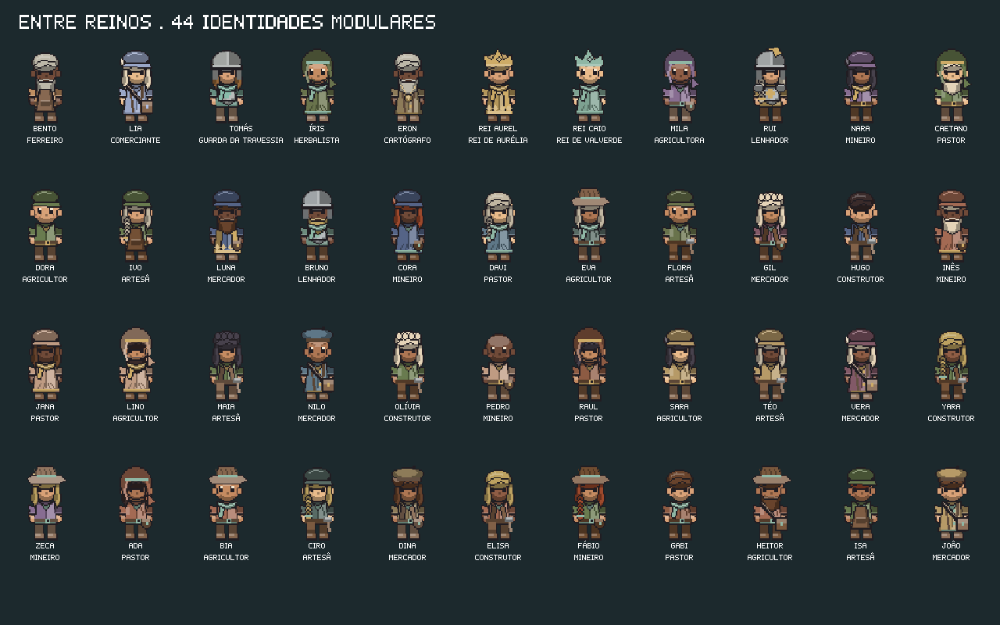

# Aparência modular dos NPCs

Os 44 moradores usam **cinco camadas**: corpo, roupa, cabelo, acessório e chapéu. O kit contém **36 spritesheets separados**, com quatro direções, repouso, caminhada e corrida. As cores são aplicadas por um shader de paleta, tanto no modo 2D quanto nos billboards 3D e retratos.



## No jogo

Cada morador mantém seu visual ao salvar, carregar e trocar de mapa. A geração usa uma seed derivada do **ID**, e o save guarda as variantes usadas para resolver coincidências. Adicionar um morador respeita as variantes já salvas. A população inteira é verificada, então moradores que se aproximam depois também têm combinações distintas.

Guardas usam armadura e elmo; nobres recebem trajes finos, e os reis conservam coroas. Camponeses usam roupas simples. Artesãos têm aventais ou cintos de ferramentas; mercadores podem usar bolsas e broches, enquanto estudiosos e herbalistas têm seus próprios conjuntos. As cores de identificação seguem o reino ou a guilda do membro. Bento, Lia e Tomás conservam sua ligação com Artífices, Rotas e Vigília.

A estatura varia até **5,5%**, usando escala uniforme para preservar as proporções. Todos os componentes compartilham o mesmo pivô e quadro de animação. A passada continua sincronizada com a distância percorrida, inclusive ao correr, virar ou encostar em obstáculos.

Os moradores principais mantêm seus nomes e histórias. NPCs genéricos recebem nomes derivados do ID; nomes repetidos são resolvidos durante a preparação da população. Saudações variam com a pessoa e o papel. Com **Som** ligado, as conversas usam pequenos sons de sílabas, com pitch, timbre, entonação e cadência próprios. São vozes estilizadas de RPG; não há dublagem das frases nem síntese de fala.

No menu **E** de um NPC, **Escolher sprite deste morador** ainda importa uma prancha completa. **Restaurar aparência modular** retorna ao kit gerado. A escolha individual fica no save. PNGs importados antes desta atualização permanecem no disco; o novo sistema passa a ser o padrão até uma nova escolha explícita, para que arquivos antigos não cubram as camadas.

## Recursos e regras no Godot

`game/appearance_data.gd` define o **AppearanceData (Resource)**. Ele expõe listas de opções por camada, as peças escolhidas, cores independentes de pele, cabelo, roupa, detalhe da facção, couro e metal, além de estatura e voz.

Os sete presets editáveis ficam em **`game/data/appearances/*.tres`**:

| Preset | Regra |
| --- | --- |
| `peasant` | Túnica, camisa de trabalho ou vestido; chapéus simples |
| `guard` | Armadura, elmo e ombreira ou lenço |
| `noble` | Roupa fina ou manto; coroa, tiara ou boina |
| `artisan` | Roupa de trabalho, avental ou ferramentas |
| `merchant` | Colete, casaco ou roupa fina; bolsa ou medalhão |
| `scholar` | Manto ou casaco; capuz e bolsa ou medalhão |
| `ranger` | Roupa de viagem; capuz, lenço e bolsa |

Abra um preset no Inspector para mudar `body_options`, `hair_options`, `clothing_options`, `accessory_options` ou `hat_options`. Os nomes devem corresponder aos arquivos do kit. A profissão escolhe o preset; `FactionCatalog.guard` também cobre os guardas voluntários. O campo opcional `faction` do perfil aceita os IDs dos reinos ou guildas. Mapas JSON preservam esse campo, inclusive ao importar `guild_artisans` como `artisans`.

`AppearanceGenerator` usa SHA-256 do ID com a versão do gerador e um RNG local. Não consome o RNG de clima ou mundo. A alocação ordena IDs, dá prioridade às escolhas salvas, detecta combinações repetidas de peças e paleta e tenta uma variante determinística. O JSON da aventura guarda `npc_appearances` e `npc_sprite_overrides`; o documento do mapa mantém seus IDs. A estabilidade se refere à mesma versão do kit; editar as regras ou os desenhos altera o resultado de propósito.

## Assets e paleta

Os desenhos novos são originais do projeto, gerados pelo script **`scripts/generate_modular_sprites.py`**. Os PNGs enviados pelo autor, em `assets/npcs` e `assets/tomate`, permanecem intactos. O protagonista continua usando o pacote original.

| Camada | Opções | Pasta |
| --- | ---: | --- |
| Corpo | 3 | `assets/modular_npcs/body/` |
| Cabelo | 7 | `assets/modular_npcs/hair/` |
| Roupa | 8 | `assets/modular_npcs/clothing/` |
| Acessório | 8 | `assets/modular_npcs/accessory/` |
| Chapéu | 10 | `assets/modular_npcs/hat/` |

Cada folha mede **240 × 512 px**, com células de **48 × 64 px**, cinco colunas e oito linhas. A coluna 0 é repouso; 1–4 são passos. As linhas são frente, costas, direita e esquerda, repetidas para a corrida. A sola está em **Y = 60**. Não há espelhamento em tempo de execução: as folhas incluem as duas direções laterais. A composição usa corpo → roupa → cabelo → acessório → chapéu.

As folhas cruas armazenam **índices**, por isso não mostram as cores finais quando abertas diretamente. O canal vermelho guarda o índice inteiro 0–31 e o alfa guarda a cobertura. O shader lê esses índices sem conversão sRGB; a textura de paleta contém as cores reais.

| Índices | Uso |
| --- | --- |
| 0 | Transparente |
| 1 | Contorno |
| 2–4 | Sombra, base e luz da pele |
| 5–7 | Cabelo |
| 8–10 | Roupa |
| 11–13 | Detalhe da facção |
| 14–16 | Couro |
| 17–19 | Metal |
| 20, 22, 24 | Claros e detalhe do rosto |

O manifesto `assets/modular_npcs/manifest.json` registra origem, medidas e hashes. Para regenerar os desenhos, use `python3 scripts/generate_modular_sprites.py` com Pillow instalado e importe o projeto no Godot. O jogo pronto não depende de Python ou Pillow.

As camadas são compostas em uma folha indexada por combinação, usando operações nativas de imagem. As animações reutilizam essa folha, e trocar a paleta não recompõe os pixels. Cada personagem mantém **um billboard**, incluindo o contorno do chapéu e dos acessórios na sombra; não são cinco cartões 3D sobrepostos.

## Verificação

```sh
./scripts/godot.sh --headless --script tests/modular_appearance_tests.gd -- --test
./scripts/godot.sh --audio-driver Dummy --script tests/modular_appearance_tests.gd -- --test --hybrid
```

A suíte mede identidade por ID, mudança na ordem de spawn, colisão real de combinações, nomes de uma população densa, regras de profissão/facção, materiais, pivôs, vozes, migração e persistência. Os testes gráficos verificam pixels de pele e roupa nas duas versões do shader. [Resultados e execução dos pacotes](modular-validacao.json).
