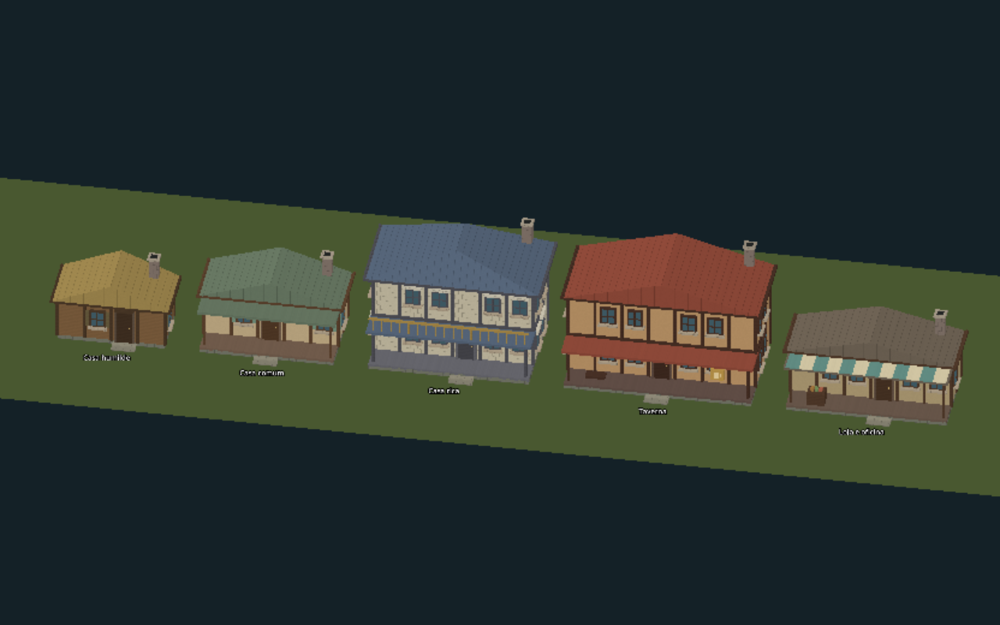
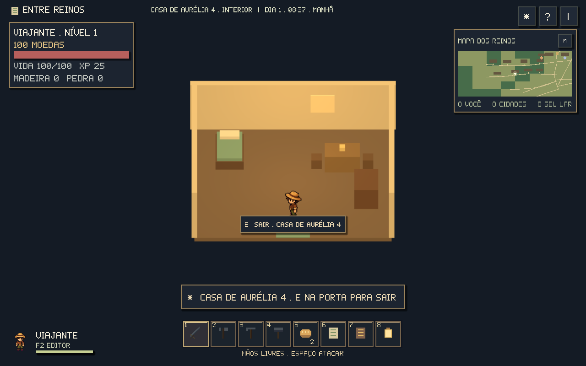
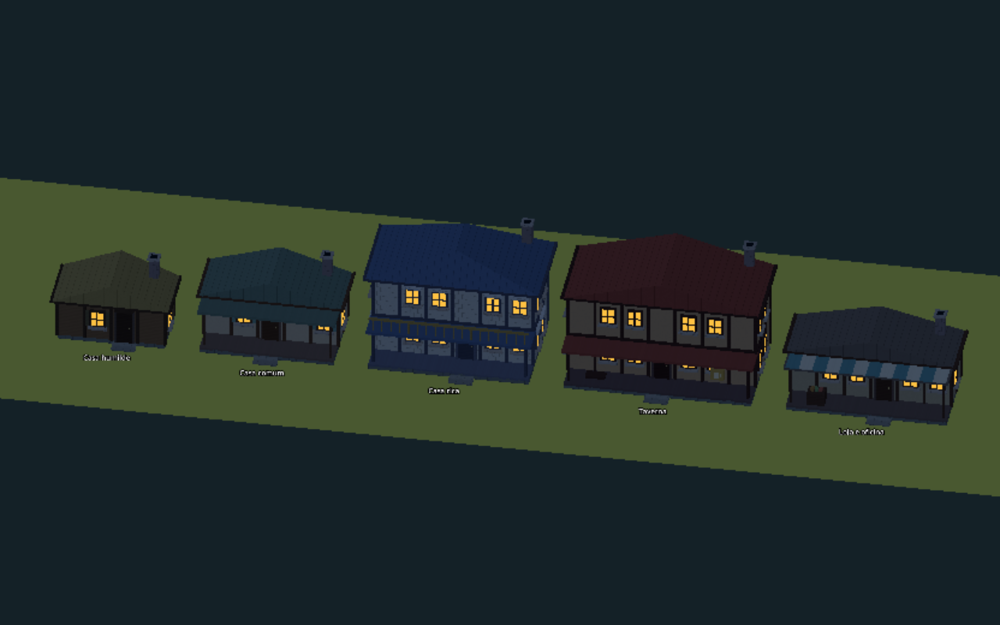

# Casas modulares

As casas de madeira, cabanas, sobrados, tavernas, lojas, bibliotecas e alojamentos agora são montados por um kit comum. Castelos e torres conservam seus modelos próprios.

## Escolher e construir

Abra **B → Casas completas · 5 kits modulares** e escolha o estilo. Na prévia, **T** gira em passos de 90° e **V** muda a semente, que controla dimensões e cores. O fantasma e o grid mostram o terreno inteiro. Verde permite reservar; vermelho indica o impedimento. Clique confirma, e Esc ou botão direito cancela.

O terreno custa **20 moedas**. Com martelo, use E na obra para executar as três etapas já existentes: **15 madeira + 10 pedra**, **20 madeira + 5 pedra**, **15 madeira + 5 pedra**. A escolha do kit altera a casa, mantendo esses custos. Há um terreno pessoal por aventura; paredes, pisos, móveis e estações avulsos continuam disponíveis no catálogo.

| HouseData | Estilo | Terreno novo, antes do giro | Detalhes |
| --- | --- | --- | --- |
| `poor.tres` | Humilde | 3–4 × 2–3 m | Madeira, palha, venezianas |
| `common.tres` | Comum | 3–5 × 3–4 m | Reboco, vigas, telhas verdes, varanda |
| `rich.tres` | Rica | 5–6 × 4–5 m | Sobrado, pedra, quatro águas, balaustrada |
| `tavern.tres` | Taverna | 5–7 × 4–5 m | Dois andares, varanda coberta, banco e letreiro de caneca |
| `shop.tres` | Loja/oficina | 4–6 × 3–4 m | Toldo listrado, balcão, mercadorias e chaminé |

Os cinco arquivos são Resources `HouseData` em `game/data/houses/`. Suas cores, alturas, andares, beirais, tamanhos e dimensões internas podem ser alterados no inspetor do Godot. Os pavimentos superiores são parte da fachada; a transição abre um interior térreo mobiliado por estilo.

## Portas e interiores

**E junto à porta** abre o interior de uma residência do cenário. Na sua casa pronta, escolha **Entrar em casa**. Nas ferrarias e tavernas, o menu da entrada mantém os serviços habituais e oferece **Entrar na loja/taverna**. Dentro, caminhe entre os móveis, use E no balcão para negociar e E na porta para sair. A cama da sua casa permite descansar; as camas da taverna usam o serviço pago de estalagem.

O inventário, os relacionamentos, as facções e a carteira são os mesmos dentro e fora. O salvamento registra a sala visitada, a posição interna e o retorno exterior separadamente. Ao continuar a jornada, você retoma o interior. Se a casa tiver sido removida do mapa, o jogo usa o retorno exterior. F2 retorna ao continente antes de abrir o editor. A colocação de construções ocorre no exterior.

O continente pausa a movimentação e a física enquanto o interior está aberto. O relógio e as filas de fabricação continuam; moradores retomam suas rotinas ao sair. Os interiores têm mobiliário fixo do kit, sem NPCs internos ou edição de móveis nesta versão.

## Ateliê de mapas

Em F2, as ferramentas **Cabana**, **Casa de madeira**, **Casa de pedra**, **Estalagem** e **Ferraria** correspondem aos cinco kits. Escolha **Casa · giro** e **Variação** na barra lateral antes de colocar. O terreno encaixa no grid de 1 m. A semente avança a cada colocação; casas já colocadas conservam sua semente no JSON.

Selecione uma casa nova para **Girar casa 90°** ou **Outra variação**. A validação impede aumentar o terreno sobre outra construção ou água. Desfazer/refazer, salvar, exportar e importar conservam as opções do kit. Objetos antigos sem essas opções mantêm suas dimensões.

## Luz, fumaça e encaixe

As janelas mudam do vidro diurno para luz quente ao anoitecer, seguindo o relógio e a opção Shaders. Degraus e beirais fazem parte do mesh e projetam sombras com HD-2D. Chaminés próximas soltam fumaça lenta com cinco partículas por casa; um pool limita o efeito às 12 chaminés mais próximas, em uma chamada de desenho. O efeito reutiliza os planos das casas já gerados; a lista de partículas só é reenviada quando as chaminés selecionadas mudam.

`WorldGrid.CELL_SIZE` permanece em **1 m**, com **64 unidades 2D por metro**. Cada kit usa um pivô no canto do chão, escala unitária e a mesma transformação para fachada, telhado, porta e chaminé. Fundação e fachadas são módulos reutilizáveis; a casa é unida em **uma superfície** para reduzir chamadas de desenho. Beirais e degraus têm extensão decorativa; não são paredes de encaixe do catálogo avulso.

Os **126 lotes herdados da geração 2** são preservados nos saves anteriores. Neles, a última peça da borda é recortada à medida do terreno. A geração 3 cria **131 lotes** depois das ruas, com dimensões inteiras e margens validadas. Casas colocadas pelo catálogo ou ateliê também usam o grid. O relatório distingue módulos avulsos, kits e lotes herdados. [Validação e realocação de casas existentes](estradas-e-posicionamento.md).

## Verificação técnica

Execute `./scripts/godot.sh --headless --script tests/house_tests.gd -- --test`. Para verificar câmera, sprites, janelas e fumaça, use a mesma execução com display gráfico e `-- --test --hybrid`, sem `--headless`. Os testes verificam os cinco Resources, os quatro giros, reprodução por semente, pivôs, terrenos preservados, colisões internas, entrada/saída, comércio e salvamento.

As suítes de jogo e casas passaram em **2.290 verificações**, incluindo o acesso a lojas e tavernas nos quatro giros. A orientação dos triângulos dos kits também é verificada para evitar faces invisíveis. O relatório está em [casas-validacao.json](casas-validacao.json).

A medição final com renderização por software llvmpipe ficou em **34,0 FPS na capital**, **31,3 na ferraria** e **31,8 na ponte**, em 1280 × 800 no modo leve, com 25 quadros de aquecimento e 45 amostras por cena. É uma medição deste ambiente, sem GPU dedicada. A fumaça adiciona uma chamada de desenho por conjunto próximo; o overlay da transição é ocultado ao terminar. [Dados de desempenho](rpg-desempenho.json).

[Grid e auditoria](construcao-grid.md) · [Construção e fabricação](construcao-e-fabricacao.md) · [Ateliê de mapas](editor-de-mapas.md)
