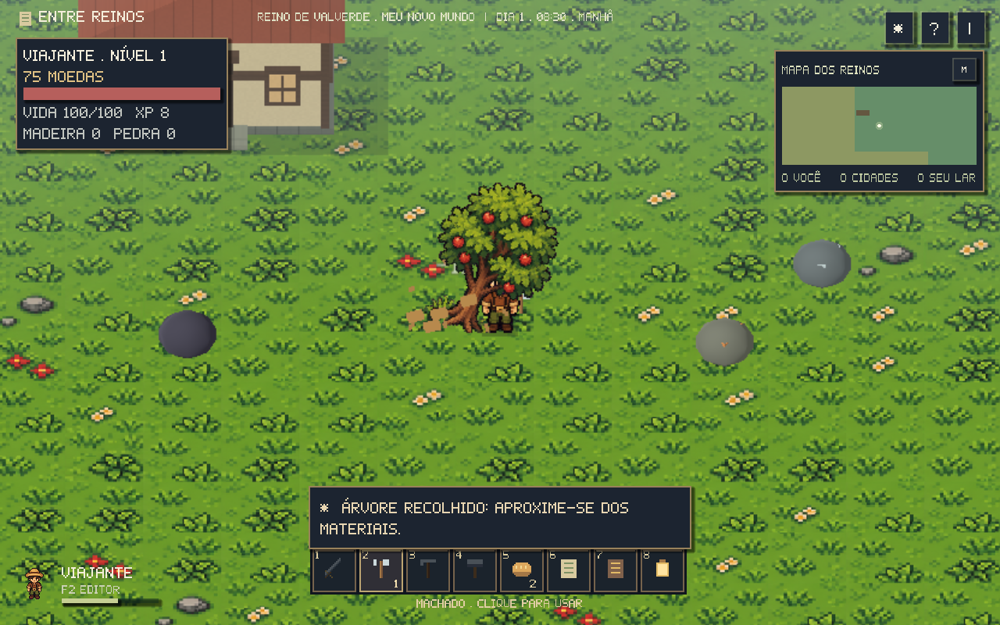
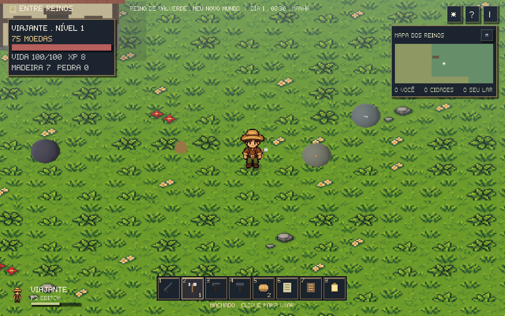

# Coleta, ferramentas e energia

Compre machado e picareta na ferraria. Eles começam no tier de madeira.
Use **E** perto de um recurso, ou selecione **2** (machado) / **3** (picareta)
na hotbar e clique. Cada golpe tem um pequeno intervalo, gasta energia e
reduz a vida do objeto. A barra verde junto ao retrato mostra a energia;
pare por um momento para recuperá-la. **I** mostra os valores e as habilidades.

Árvores tremem nos impactos, caem e deixam tocos. Rochas se desfazem em
fragmentos. Madeira, pedra, cobre e ferro saltam para o chão, quicam e são
atraídos quando você se aproxima. Só então entram no inventário. Ative
**Som** para ouvir impactos diferentes na madeira e na pedra.

| Objeto | Vida | Ferramenta mínima | Retorno |
| --- | ---: | --- | --- |
| Árvore | 36 | Machado de madeira | 3 dias |
| Rocha | 40 | Picareta de madeira | 5 dias |
| Rocha dura | 70 | Picareta de pedra | 5 dias |
| Cobre | 64 | Picareta de pedra | 5 dias |
| Ferro | 80 | Picareta de pedra | 7 dias |
| Basalto | 100 | Picareta de ferro | 7 dias |

Os depósitos especiais estão nas montanhas e podem ser colocados em
**F2 → Natureza**. Minérios têm manchas visíveis na rocha. Cada tipo tem
sua tabela de drops, com quantidade variável e chances de materiais extras.

Na página de ferramentas da ferraria, escolha **Melhorar**:

- Pedra: 40 moedas, 5 madeira e 10 pedra por ferramenta.
- Ferro: 90 moedas e 6 ferro por ferramenta.

Ferramentas melhores causam mais dano e economizam energia. Lenhador e
mineiro ganham experiência com os golpes e a conclusão da coleta; seus
níveis dão bônus de dano e eficiência. O pequeno número na hotbar indica
o tier: 1 madeira, 2 pedra, 3 ferro. Cobre e ferro também podem ser vendidos.

O retorno usa os dias do relógio do jogo. Um recurso espera se o jogador
ou uma casa ocupa o local. Vida parcial, tocos, dias de retorno, drops ainda
no chão, habilidades e ferramentas ficam no save. Sair durante a queda ou
viajar para outra região não duplica o saque.

