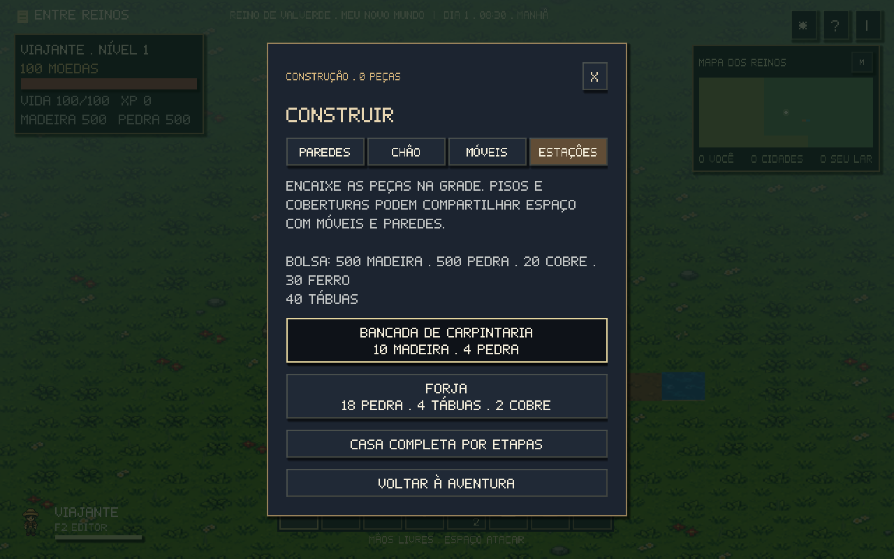
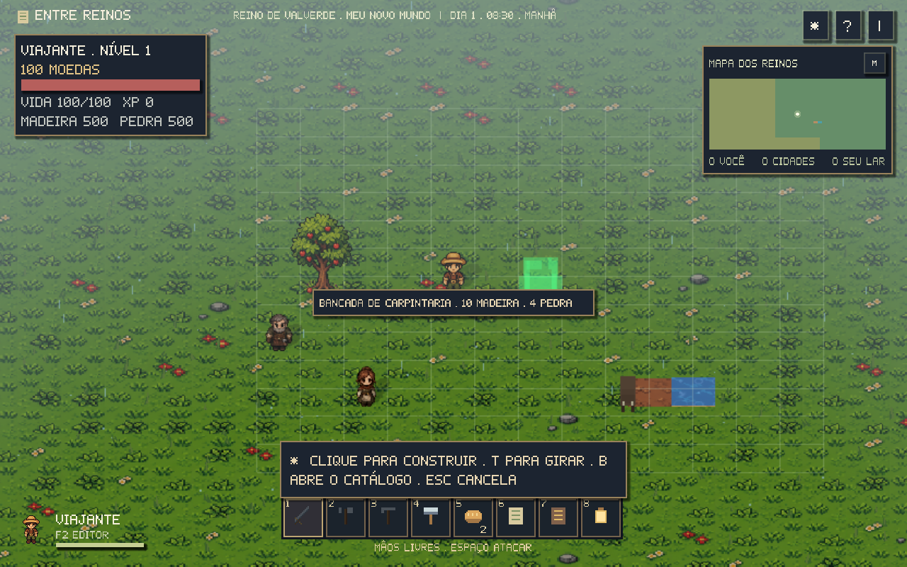
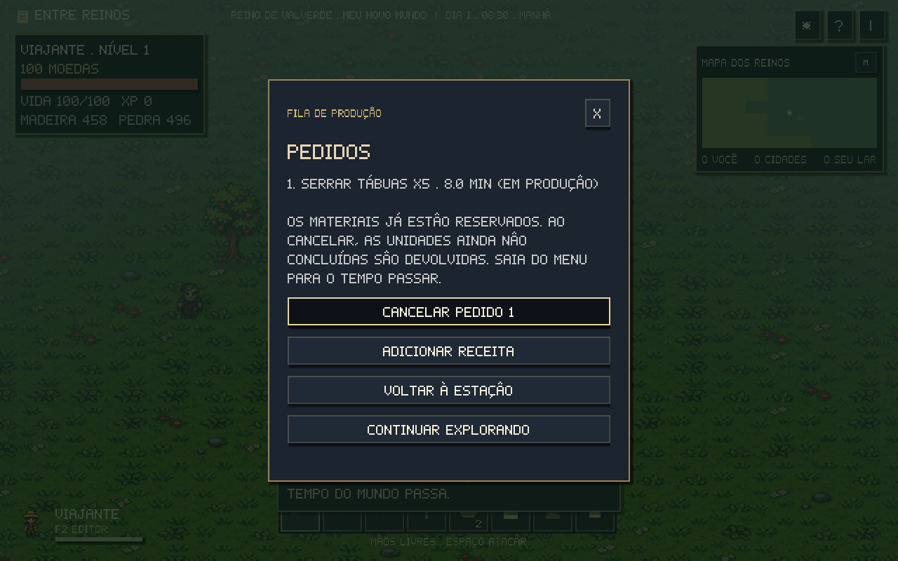
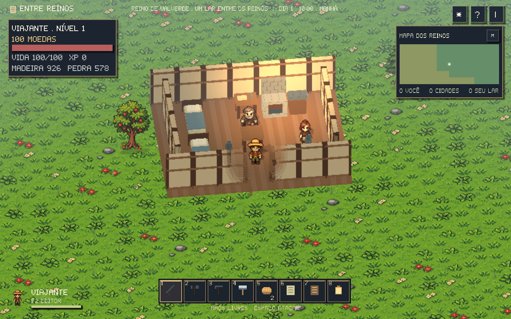

# Construção e fabricação

**B** abre o catálogo. Escolha **Paredes**, **Chão**, **Móveis** ou **Estações**. Cada peça mostra seu custo antes de selecionar. É preciso ter um martelo, comprado na ferraria.

## Montar seu lugar

O fantasma **verde** indica uma posição válida; o **vermelho** explica o impedimento. Clique para construir e continuar colocando a mesma peça. **T** gira a peça em passos de 90°. **B** volta ao catálogo; **Esc** ou botão direito sai da prévia. Q/R continuam girando a câmera.

Pisos, objetos e coberturas usam camadas diferentes: é possível colocar uma cama ou parede sobre um piso e adicionar cobertura acima. Objetos da mesma camada não se sobrepõem. Portas abrem e fecham pelo menu **E**; uma porta não fecha enquanto alguém ocupa a passagem.

A grade tem células de 64 unidades. As peças precisam estar a até 500 unidades do personagem, em terra firme, fora de ruas, pontes, rios, recursos vivos, edifícios e lotes dos moradores. Personagens e animais também bloqueiam a colocação de peças sólidas. Uma bancada ou cama precisa ter acesso livre na frente; gire com T se necessário.

## Da madeira à forja

1. Reúna **10 madeira e 4 pedra** e construa uma **bancada de carpintaria**.
2. Aproxime-se, use **E → Receitas e produção → Serrar tábuas**. Cada pedido transforma **2 madeira em 2 tábuas**, em oito minutos do relógio do jogo.
3. Uma **cama** usa **8 madeira e 2 tábuas**. Uma **forja** usa **18 pedra, 4 tábuas e 2 cobre**.
4. A bancada também talha blocos e fabrica ferramentas de pedra. A forja funde cobre e ferro e fabrica ferramentas de ferro e espada.

As receitas permitem uma unidade ou lotes de cinco, conforme o produto. Ferramentas são produzidas uma por vez e não substituem uma ferramenta melhor por outra inferior. Cada estação aceita até oito pedidos e trabalha em sequência; estações diferentes produzem em paralelo.

Ingredientes são reservados ao adicionar o pedido. Os produtos prontos vão para o inventário. Cancelar devolve os ingredientes das unidades que ainda não terminaram, inclusive a unidade em andamento; seu progresso é descartado. Produtos já entregues permanecem no inventário.

A produção acompanha o tempo do mundo: sair do menu permite que ela avance; menus e prévia de construção pausam o relógio. Descansar até a manhã avança a produção. Fechar o jogo guarda o tempo restante para retomá-lo ao carregar.

## Vida, reparo e benefícios

**E** abre a vida e as ações de uma peça. Javalis podem danificar paredes, móveis, estações e a casa do jogador quando bloqueiam uma perseguição. **Reparar** exige martelo e cobra uma fração dos materiais, proporcional ao dano. Estruturas intactas não cobram reparo. Estações com até 25% de vida suspendem a fabricação até serem reparadas.

**Desmontar peça** mostra uma confirmação e recupera até metade do custo, conforme a vida restante. Desmontar ou perder uma estação cancela seus pedidos e devolve ingredientes ainda reservados. Designações ligadas à peça são liberadas.

Uma **cama livre → Descansar e salvar** recupera vida, passa o tempo até a manhã e define o ponto de retorno se o aventureiro for socorrido. A cama aparece como seu lar no mapa. Coberturas abrigam da chuva; tochas e forjas participam da iluminação do cenário.

## Moradores e trabalhadores

Use **E** na cama e escolha **Designar morador**. Na bancada ou forja, escolha **Designar trabalhador**. A lista mostra primeiro os NPCs próximos e tem páginas para os demais. Uma cama recebe um morador e uma estação recebe um trabalhador. Reatribuir o mesmo NPC libera sua designação anterior daquele tipo.

O NPC caminha até o trabalho durante seu turno, mantém pausas e passeios e volta à cama designada à noite. Um trabalhador presente acelera a produção da estação em **25%**. Ele também faz pausas para se alimentar com suas próprias provisões ou moedas. Uma cama designada a um NPC deixa de ser o ponto de retorno do jogador.

## Salvamento e mapas

O save guarda tipo, posição, orientação, vida, portas abertas, moradores, trabalhadores, cama escolhida, materiais processados e tempo restante dos pedidos. O arquivo é atualizado por gravação temporária e substituição, preservando o anterior se a gravação falhar. Cada mapa do ateliê mantém seu próprio assentamento e progresso.

As casas antigas por etapas continuam disponíveis em **B → Casa completa por etapas**, com seus custos anteriores. Saves antigos preservam casas, ferramentas e inventário; as casas recebem vida e podem ser reparadas.

O limite é de 1.024 peças por mapa. Modelos 3D acompanham as regiões carregadas; sair da região libera a imagem e voltar reconstrói as peças. Não é preciso manter todos os modelos do continente desenhados.

## Alterar receitas no projeto Godot

O catálogo e as receitas ficam em `game/data/construction.json`. Cada receita define `id`, `name`, `station`, `minutes`, `cost` e `output`, ou uma ferramenta em `tool`/`tier`. `workbench` e `forge` separam os níveis de fabricação. Os quatro materiais processados são tábuas, blocos de pedra e lingotes de cobre e ferro. Reexporte os executáveis depois de alterar os dados.
