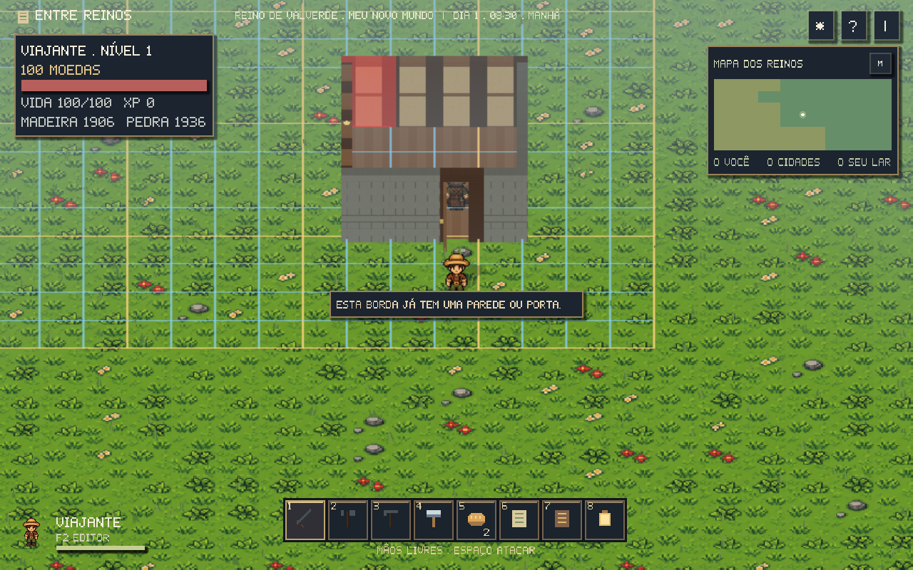
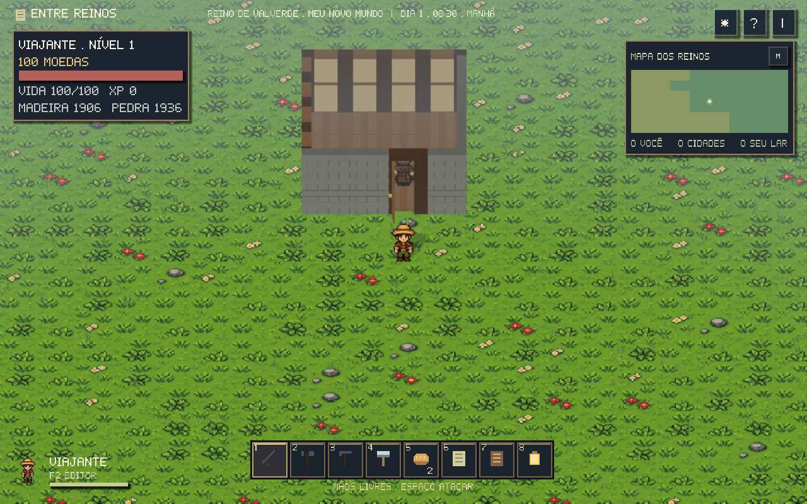
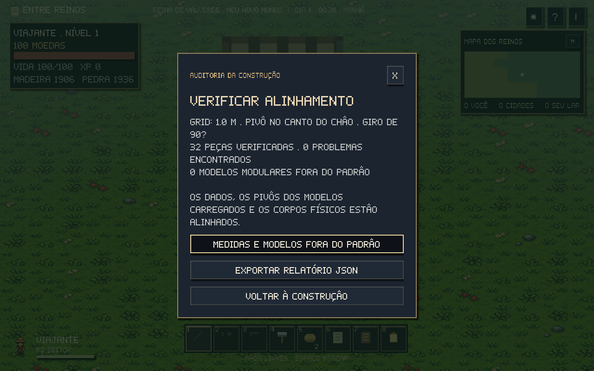

# Grid e alinhamento das construções

O catálogo modular agora usa **células horizontais de 1 m**, com **pivô em um canto local no chão**, escala da raiz **1, 1, 1** e giros de **90°**. A medida está em `WorldGrid.CELL_SIZE`, em [game/world_grid.gd](../game/world_grid.gd). Um metro corresponde às 64 unidades da simulação 2D; o cenário 3D usa metros.



## O que causava as linhas e os desalinhamentos

Antes, `ConstructionCatalog.cell()` arredondava para centros de células, mas `footprint()` subtraía meia célula e aumentava a área para o lado positivo. Uma cama ou forja girada mudava o centro de referência. Paredes usavam uma célula inteira da camada de objetos: não havia um endereço próprio para a borda nem uma junção de canto.

A geometria também divergia do catálogo. Tábuas tinham 0,194 m de largura para um espaçamento de 0,2 m, deixando frestas de 6 mm. A cobertura tinha 1,04 × 1,04 m em uma célula de 1 × 1 m, sobrepondo módulos vizinhos. Travessas e molduras alteravam alturas e espessuras sem atualizar a medida declarada.

As medições originais foram guardadas antes da refatoração em [grid-audit-before.json](grid-audit-before.json), com a revisão do código usada. O relatório atual está em [grid-audit.json](grid-audit.json); a lista explicada dos modelos está em [modelos-fora-grid.md](modelos-fora-grid.md).

## Como colocar as peças

Use **B** para escolher uma peça. O cursor escolhe a célula ou borda mais próxima, conforme o tipo. **T** gira a peça; clique constrói; **B** volta ao catálogo; **Esc/botão direito** cancela.

- Pisos, coberturas, móveis e estações ocupam um número inteiro de células. Uma cama ocupa 1 × 2; uma forja, 2 × 1. A área gira junto com a peça.
- Paredes e portas ocupam um **segmento de borda de 1 m**. Giros opostos representam a mesma borda e não permitem cobrar ou construir duas vezes.
- A raiz de cada peça fica em um vértice do grid, no chão. A prévia compensa o canto escolhido ao girar uma peça maior, mantendo seus limites nas linhas da grade.
- Linhas azuis mostram cada metro; linhas douradas reforçam intervalos de quatro metros. O ponto dourado marca o pivô. As guias aparecem apenas durante a construção, nos modos 2D e 3D.

Paredes têm **2 m de altura** e **0,25 m de espessura**. Piso de madeira e pedra têm a mesma altura, **0,08 m**. A cobertura começa em **2 m** e termina em **2,12 m**, encontrando o topo das paredes. Cada piso e cobertura preenche exatamente sua célula.

Móveis e estações podem ser menores que sua área reservada. Sua geometria fica centralizada dentro dela e deixa uma folga para a espessura das paredes. Isso permite mobiliário ao lado de paredes sem invadir a junção.

## Cantos, portas e navegação

Dois, três ou quatro segmentos que chegam ao mesmo vértice compartilham uma única junção. Os painéis terminam na junção; uma só peça gera o poste comum. Remover ou adicionar uma parede atualiza os modelos e colisores vizinhos. A parede de madeira, a de pedra e a porta usam a mesma referência e altura.



A porta aberta libera o vão, mantendo os postes necessários nos cantos. A navegação usa amostras de **0,5 m** para conseguir distinguir a borda fechada do centro do vão aberto. Essa resolução de navegação não muda a célula de construção de 1 m. O teste percorre um quarto fechado, abre sua porta e verifica um NPC atravessando com física real.

## Validar as peças existentes

Abra **B → Validar grid e modelos**. A ferramenta percorre todas as peças do save, mesmo quando seus modelos estão em regiões distantes. Nos modelos carregados, compara também posição, rotação, escala e pivô do colisor.

Ela aponta o **ID** e o motivo de cada problema: coordenada fracionária, giro inválido, modelo desconhecido, borda duplicada, sobreposição na mesma camada, posição fora do mundo ou divergência entre dados, modelo e corpo físico.

**Medidas e modelos fora do padrão** apresenta a situação dos 12 módulos e dos prédios completos do cenário. **Exportar relatório JSON** grava `user://reports/<mapa>-grid.json`; o jogo mostra o caminho completo. A validação não remove nem reposiciona peças.



Para validar um arquivo fora do jogo, no projeto Godot:

```sh
./scripts/godot.sh --headless --script scripts/validate_construction.gd -- \
  --input /caminho/journey.json --report /tmp/grid-audit.json
```

O comando aceita uma jornada completa, um objeto `rpg`, ou os dados de `construction`. Sem `--input`, mede apenas o catálogo e os prefabs. Retorna **0** quando as peças e módulos estão conformes, **1** quando encontra problemas e **2** quando não consegue ler ou escrever o arquivo. O arquivo de entrada é somente lido.

## Saves anteriores

O save de construção agora grava `grid_version: 2`. Ao abrir um arquivo anterior com peças, o jogo guarda uma cópia **`<save>.grid-v1.bak`** antes do próximo salvamento. A conversão ajusta a referência antiga ao canto do novo grid e mantém **IDs, vida, portas, moradia, trabalho, cama escolhida, estoque e filas**, incluindo o tempo parcial de produção.

A conversão acontece uma única vez. Se o jogador estiver dentro de uma estrutura após o ajuste, sua posição é levada a um ponto livre próximo. Se não for possível criar a cópia original, o jogo mantém a aventura em memória sem sobrescrever o save.

Peças já separadas por uma célula vazia continuam separadas; a migração não inventa paredes para fechar uma abertura que poderia ser intencional. As novas bordas permitem completar esses cantos pelo catálogo.

Casas completas antigas e os prédios das cidades continuam como prefabs, preservando os lotes e o desenho dos mapas. A casa por etapas recém-reservada também encaixa seu terreno de 3 × 2 m na grade. As raízes dos modelos completos usam canto no chão, mas seus telhados e detalhes decorativos não fazem deles módulos intercambiáveis.

## Arquivos principais

- `game/world_grid.gd`: medida, conversão, pivô, giros e endereços de borda.
- `game/construction_catalog.gd`: snap, área ocupada, segmentos e junções.
- `game/construction_state.gd`: ocupação, prevenção de duplicação e migração.
- `game/construction_visual.gd`: meshes ajustados ao padrão.
- `game/construction_audit.gd`: diagnóstico de dados e geometria.
- `scripts/validate_construction.gd`: ferramenta de linha de comando.
- `tests/grid_tests.gd`: medições de meshes, raios nos cantos, física, navegação, guias, migração e relatórios.
