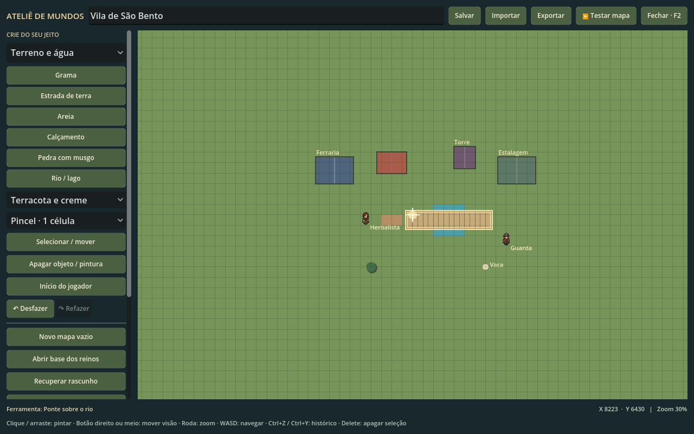

# Seu mapa, dentro do jogo

Não é preciso instalar outra ferramenta: o **Ateliê de Mundos** acompanha os executáveis de Linux e Windows. Abra com **F2**, pelo botão **Criar meu mapa** na tela inicial ou pelo menu de pausa.

## Começar

1. Abra o ateliê. Você verá a base dos reinos ou o mapa que estiver jogando.
2. Use **Novo mapa vazio** para construir um mundo do zero. **Abrir base dos reinos** abre uma cópia editável do continente original.
3. Escolha uma categoria e um pincel na coluna esquerda. Clique ou arraste para pintar grama, terra, areia, calçamento, musgo e água. O pincel pode ter 1, 3, 5 ou 9 células.
4. Em **Construções**, coloque casas de campo, madeira ou pedra, ferrarias, estalagens, torres, castelos e pontes. Há seis estilos de cores e materiais. As pontes atravessam na horizontal; desenhe o trecho do rio sob elas.
5. Adicione árvores, rochas, animais e moradores nas outras categorias.
6. Marque **Início do jogador** em terra firme. Clique em **Testar mapa** para entrar e explorar o seu mundo.

O continente tem 250 × 200 células de 64 unidades. Roda do mouse aproxima e afasta; botão direito ou do meio arrasta a visão. WASD/setas também navegam. **Ver continente** e **Ir ao início** ficam mais abaixo na coluna; role para encontrá-los.

## Selecionar, mover e apagar

Use **Selecionar / mover** e clique em um objeto. Clique em um ponto vazio para movê-lo. **Delete** apaga a seleção. O pincel **Apagar objeto / pintura** remove objetos ou devolve um terreno pintado à base anterior. Casas da base original podem ser apagadas e substituídas pelos modelos da paleta.

**Ctrl+Z** desfaz e **Ctrl+Y** refaz. Uma pincelada arrastada conta como uma ação. O histórico guarda até 30 ações desta sessão. Pintar um terreno substitui a vegetação e os recursos gerados automaticamente naquela célula; os objetos colocados manualmente continuam lá até você apagá-los.

O desenho do ateliê é uma planta de cima. **Testar mapa** mostra a aparência final em 2.5D, com os shaders, personagens e construções.

## Rotinas dos moradores

Na categoria **NPCs**, escolha a aparência antes de colocar o morador. Ferreiro, comerciante, guarda, herbalista, sábio, dois reis, camponesa e agricultor têm bases visuais diferentes.

Selecione um NPC e role até **Objeto selecionado**. Você pode mudar seu nome, pressionando Enter para confirmar, e marcar três pontos no mapa:

- **Casa / descanso**: para onde ele volta à noite.
- **Trabalho**: seu destino de manhã e de tarde.
- **Passeio**: mercado ou ponto de encontro do meio-dia e da noite.

Os horários e as velocidades variam entre os moradores. A navegação evita casas, rochas, árvores e água; use pontes para conectar margens. As rotinas definidas no ateliê substituem as do morador selecionado. Os quatro construtores autônomos continuam funcionando na base original enquanto suas rotinas não forem editadas.

## Salvar e compartilhar

**Salvar** ou **Ctrl+S** guarda o rascunho neste computador. **Fechar / F2** também guarda alterações pendentes, sem aplicá-las à aventura em andamento. Use **Recuperar rascunho** para continuar depois de reabrir o jogo.

**Exportar** abre uma janela para escolher onde gravar o arquivo `.json`. Esse arquivo contém o terreno, as construções, os animais, os moradores, seus pontos de rotina e o início do jogador. Para usar em outro computador, abra **Importar**, escolha o JSON e clique em **Testar mapa**.

O pacote inclui **MAPA-EXEMPLO.json**. Você também pode baixar o [exemplo da Vila de São Bento](mapa-exemplo.json) e importá-lo.

Cada mapa tem uma aventura separada, com seu inventário e progresso. **Voltar à aventura original** recupera o continente e o save anteriores. A base original permanece disponível; seus mapas são guardados separadamente.

Arquivos locais ficam em `user://maps`: normalmente `%APPDATA%/EntreFolhas/maps` no Windows e `~/.local/share/EntreFolhas/maps` no Linux. `active.json` indica o mundo em uso, `draft.json` guarda o último rascunho, e cada mapa tem um JSON próprio e um arquivo de jornada. O nome antigo da pasta foi preservado para compatibilidade com saves anteriores.

## Aparência e desempenho

As cidades usam seis paletas e modelos com vigas, janelas, chaminés, toldos, telhados e torres. A população mistura os sprites originais de NPCs enviados em `abc.zip` com o agricultor de `tomate.zip`, mantendo os PNGs intactos e o alinhamento das caminhadas.

Os novos shaders acrescentam movimento e brilho à água e detalhes aos materiais das construções. O modo nítido também inclui uma correção suave de cor. **Esc → Shaders** desliga esses efeitos; **Esc → Gráficos** alterna entre leve e nítido. A interface permanece na resolução integral.
