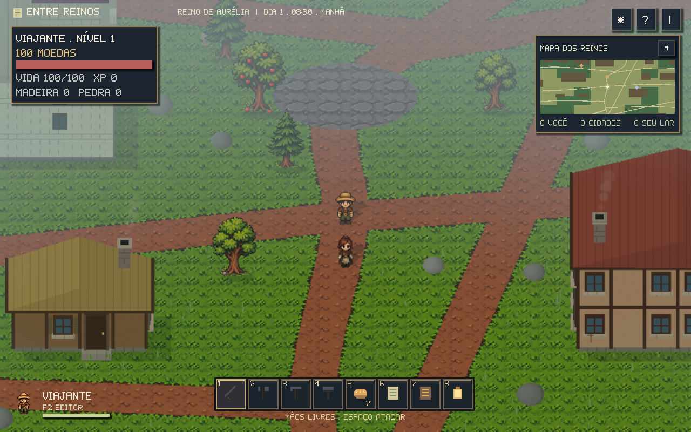
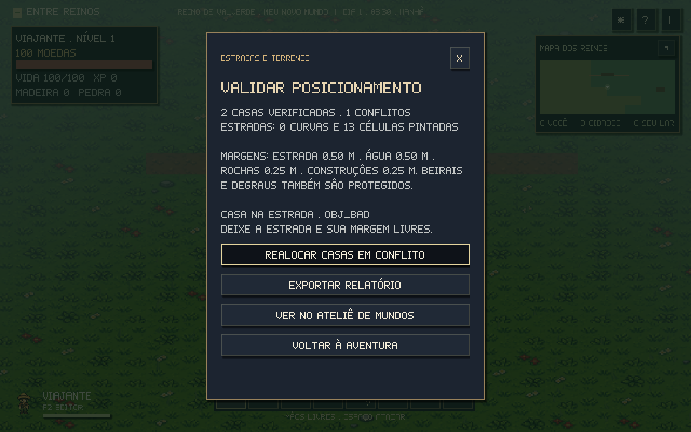
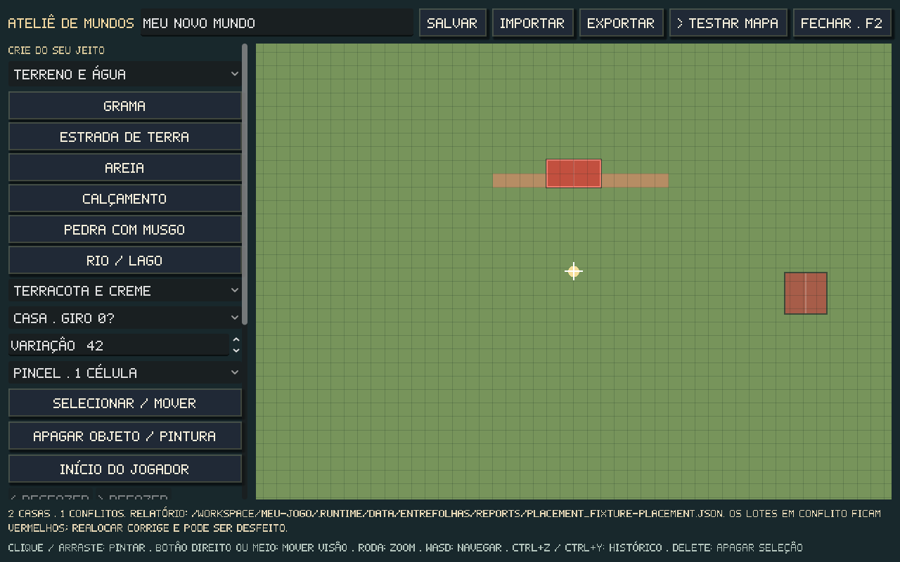

# Estradas e posicionamento

Casas novas, peças avulsas, reservas dos NPCs e construções no ateliê passam pela mesma validação de área. Ela considera toda a planta, as bordas visíveis da estrada, água no interior do lote, rochas, árvores, outras construções e terrenos reservados. A prévia explica o impedimento antes de cobrar recursos.



## Verificar e corrigir no jogo

1. No exterior, abra **B → Validar estradas e terrenos**.
2. O relatório mostra nome, ID e motivo de cada conflito. **Exportar relatório** grava um JSON em `user://reports/`.
3. **Realocar casas em conflito** procura terreno seguro num raio de **32 m**, encaixa no grid e orienta a fachada para a rua mais próxima. O mundo fica pausado e a busca avança em lotes entre os quadros.
4. O jogo atualiza desenho, colisões, portas e pontos associados; salva mapa e aventura. **Desfazer última realocação** restaura a disposição anterior durante a sessão.

Antes de aplicar, o jogo guarda o save em `<save>.placement.bak` e o mapa em `user://maps/<id>.placement.bak.json`. Vida, materiais, filas, IDs e vínculos são preservados. Casas sem espaço seguro permanecem onde estavam e continuam listadas; a ferramenta não força um encaixe inválido.



Em **F2**, os botões **Validar estradas e terrenos** e **Realocar casas em conflito** ficam na barra lateral, abaixo das ferramentas. Lotes inválidos ficam vermelhos, e a faixa azul mostra a proteção das estradas. A correção do rascunho admite **Ctrl+Z / Ctrl+Y**; **Testar mapa** aplica o resultado à aventura. A auditoria de B inclui também as casas pessoais salvas; a de F2 examina as casas do documento editado.



Pintar uma estrada sob uma casa já existente pode criar um conflito: valide novamente depois de alterar terrenos ou importar um mapa. Pontes são a exceção explícita para atravessar água e estradas; continuam sujeitas a obstáculos e outras construções.

## Margens e geração

O recurso `game/data/placement_rules.tres` controla as distâncias em metros. `WorldGrid` mantém **1 m por célula** e **64 unidades 2D por metro**.

| Regra | Padrão |
| --- | ---: |
| Estrada, além da faixa visível | 0,50 m |
| Água | 0,50 m |
| Rocha/árvore | 0,25 m |
| Outra construção | 0,25 m |
| Envelope conservador de beirais/degraus | 0,50 m por casa |
| Afastamento adicional dos lotes de vila | 1 m |
| Busca de realocação | 32 m |

O gerador cria **todas as estradas antes das casas**. Depois distribui serviços e moradias ao longo delas, reserva áreas de trabalho, gira as fachadas em passos de 90° e aceita apenas plantas inteiras no grid. Não acrescenta acessos largos depois de posicionar as casas. A geração 3 atual contém **131 construções e 87 curvas**, com **zero conflitos** na auditoria completa. Árvores e rochas procedurais respeitam os lotes e seus detalhes.

Saves existentes continuam usando sua geração anterior: a disposição 2 foi congelada em `game/data/settlements_v2.json`, mantendo IDs e coordenadas. A ferramenta de correção altera apenas os lotes rejeitados. Na reprodução dessa base, o relatório identificou 126 conflitos; a busca padrão corrigiu **124** e listou **dois castelos** sem local livre no raio. [Antes](placement-audit-before.json) · [Resultado da realocação](placement-relocation.json) · [Nova geração](placement-audit.json).

## RoadManager

`game/road_manager.gd` registra ruas como `Curve3D`, gera nós `Path3D` no grupo `RoadManagerPaths` e registra células pintadas de terra, calçamento e pedra com musgo. Desenho e validação compartilham pontos, largura, borda, pontas arredondadas e praças. Alterar uma curva registrada atualiza o índice espacial e a malha do chão.

`register_path(id, pontos_2d)` recebe unidades do mundo; `register_curve(id, curva, largura_em_metros)` recebe uma curva no plano XZ. A rua padrão tem meia largura de 44 unidades e borda de 7,5: a área protegida inclui as duas. As consultas verificam retângulos completos contra segmentos varridos, em um índice de 512 unidades. Pintura de terreno substitui apenas a parte coberta da rua de base.

`game/placement_validator.gd` compartilha essas consultas entre editor, jogador, peças e construtores NPCs. A água usa as mesmas faixas de 32 unidades da malha do rio. Recursos próximos podem ser consultados mesmo em regiões descarregadas.

## Verificação por script

Na raiz do projeto, sem alterar os arquivos de entrada:

```sh
./scripts/godot.sh --headless --script scripts/validate_placement.gd -- \
  --map meu-mapa.json --report /tmp/posicionamento.json

./scripts/godot.sh --headless --script scripts/validate_placement.gd -- \
  --map meu-mapa.json --save minha-aventura.json --fix \
  --output-map /tmp/mapa-corrigido.json \
  --output-save /tmp/aventura-corrigida.json \
  --radius-metres 32 --report /tmp/realocacao.json
```

Sem `--map` e `--save`, verifica a nova geração original. Um save original sozinho seleciona sua geração; um save de mapa personalizado exige o respectivo `--map`. O raio opcional aceita 1–64 m. Saídas de mapa, save e relatório devem ser distintas das entradas e entre si. Código de saída **0** significa sem conflitos, **1** indica conflitos restantes e **2** indica entrada ou escrita inválida. O relatório de correção contém `before`, `after`, `moved` e `unresolved`, com IDs e coordenadas.

As suítes de geometria, editor e jogo cobrem curvas diagonais, pontas, margens, água entre antigas amostras, pedras visíveis, peças, reservas de NPC, realocação, persistência, desfazer e edição de `Curve3D` em execução. [Resultados](placement-validacao.json).
