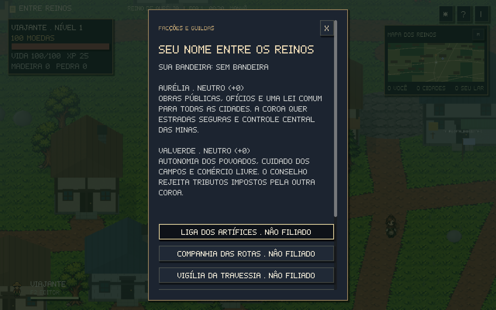
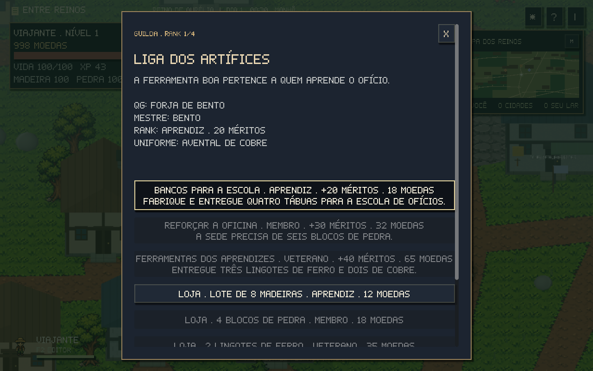
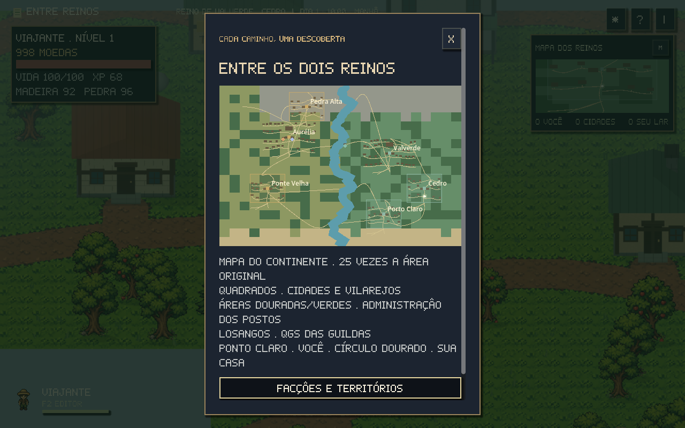
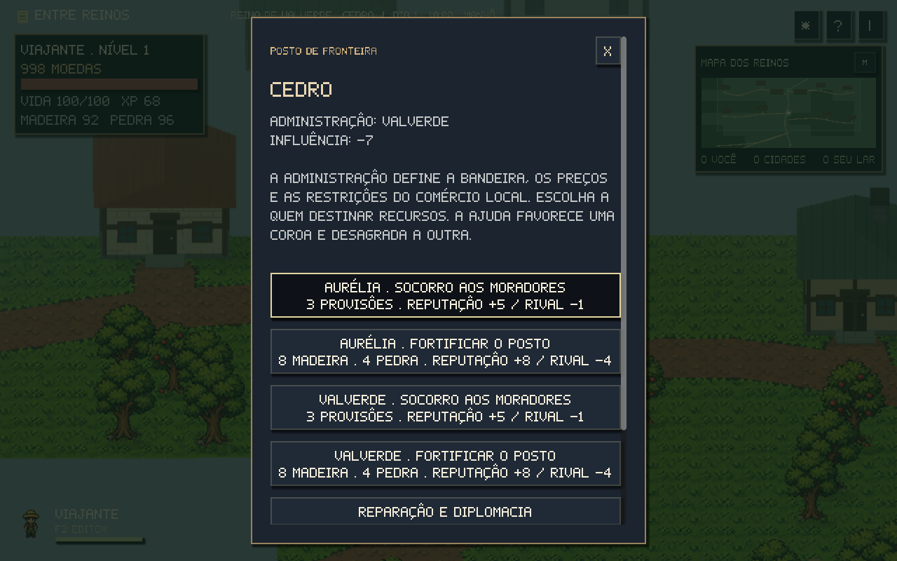
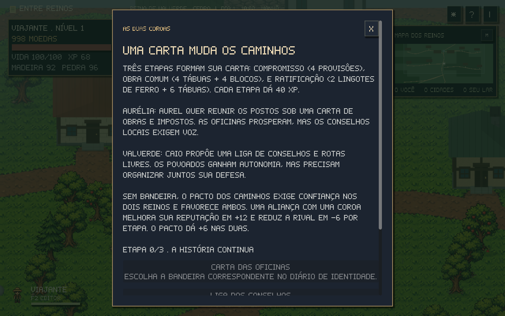

# Facções, guildas e fronteiras

Abra **J → Facções, guildas e territórios**. **E** nas bandeiras do mundo abre um QG ou posto; os mestres também recebem você durante suas rotinas. O diário permite consultar a progressão de longe. Filiação, contratos, compras e entregas precisam da presença no lugar correspondente.

## Duas ideologias, reputações separadas

**Aurélia** defende obras públicas, ofícios e uma lei central. Quer reunir estradas e minas sob uma carta comum de impostos e serviços. **Valverde** prefere conselhos locais, autonomia dos povoados e comércio livre. As duas reputações vão de **-100 a +100**, compartilhadas com os diálogos e missões pessoais já existentes.

| Reputação | Estado | Consequência |
| --- | --- | --- |
| -100 a -30 | Hostil | Comércio, estalagem e entrada na praça da capital recusados |
| -29 a -1 | Neutro, com desconfiança | Compras e melhorias custam 25% mais |
| 0 a 29 | Neutro | Preços normais |
| 30 a 69 | Aliado | Desconto de 10% |
| 70 a 100 | Herói | Desconto de 20% |

Os preços são arredondados para cima e mostrados antes da compra. Venda de materiais mantém o preço base. Encomendas do comércio dão **+4** com a administração local e **-1** com a rival. Presentes pessoais continuam afetando o morador, sem mudar automaticamente a política de todo o reino.

A partir de **-60**, Tomás e a milícia voluntária das capitais perseguem você quando acordados e próximos. Eles usam as rotas, colisões e animações dos NPCs. Ao alcançar, cobram até **10 moedas**, retiram você da área e dão um intervalo para escapar. A patrulha volta à rotina quando perde o alvo, encontra água, sai da própria região ou a hostilidade termina. Amigos que já têm afinidade 30 ainda conversam; outros moradores recusam contato nessa faixa.

Em **Reparação e acontecimentos**, entregue **15 moedas e 2 provisões** em qualquer posto ou QG: recupera até **15 reputação**, uma vez por reino ao dia, até chegar a zero. A reparação continua disponível durante hostilidade e preserva o histórico.

## Três guildas

| Guilda | Mestre e QG | Proposta | Uniforme |
| --- | --- | --- | --- |
| Liga dos Artífices | Bento, Forja de Bento | Oficinas, construção e ferramentas | Avental de cobre |
| Companhia das Rotas | Lia, Entreposto da Taverna do Oeste | Caravanas e caminhos abertos | Capa das rotas |
| Vigília da Travessia | Tomás, Quartel da Travessia | Defesa das estradas e viajantes | Tabardo da vigília |

A filiação custa **20 moedas** e inclui o uniforme. Você pode pertencer às três guildas e vestir um uniforme de cada vez. A roupa muda de cor no sprite e no billboard 3D; guardar restaura sua paleta. O uniforme não engana guardas nem apaga reputação.

| Rank | Méritos acumulados |
| --- | ---: |
| Aprendiz | 0 |
| Membro | 30 |
| Veterano | 75 |
| Mestre | 150 |

Cada guilda tem três contratos exclusivos, três lotes de loja e progressão própria. Aprendizes começam entregando tábuas, provisões ou afastando um javali. Ranks maiores abrem alvenaria, lingotes, rotas e patrulhas mais longas. A missão mostra os materiais, méritos e moedas; a entrega consome materiais reais e os transfere ao mestre. Cada conclusão também dá +4 de reputação com o reino da sede.

Há um contrato ativo por guilda. Um mesmo contrato só pode ser pago uma vez por dia; cada lote da loja também é diário. Visitas e combate precisam acontecer **depois de aceitar**. Abandonar não cobra material, pois a reserva só acontece na entrega. Hostilidade com o reino do QG suspende os serviços, preservando filiação, méritos e contratos.

## Quatro postos disputados

**Pedra Alta e Ponte Velha** começam sob Aurélia. **Porto Claro e Cedro** começam sob Valverde. As capitais mantêm suas Coroas. A bandeira de cada posto fica ao sul do povoado, e o mapa mostra suas áreas de administração. Losangos marcam os QGs.

Em um posto, escolha a quem entregar apoio:

| Apoio | Custo | Influência | Reputação escolhida / rival |
| --- | --- | ---: | ---: |
| Socorro aos moradores | 3 provisões | 14 | +5 / -1 |
| Fortificar o posto | 8 madeira + 4 pedra | 28 | +8 / -4 |

A influência é um eixo: **positivo favorece Aurélia**, **negativo favorece Valverde**. O posto troca de administração ao alcançar **+60 ou -60**. Cada posto recebe um apoio por dia, mesmo se você trocar de bandeira. Sem manutenção, perde dois pontos diários de influência em direção ao centro; a administração permanece até a rival alcançar sua maioria. A disputa avança com os recursos e escolhas do jogador.

Quando o controle muda, a bandeira do mundo, a área e o marcador do mapa mudam junto. O comércio e as caravanas usam a reputação com a **nova administração**. Os moradores mantêm suas origens, identidades e relacionamentos pessoais.

## Uma história conforme sua aliança

**As cartas das duas Coroas** oferece três caminhos. Escolha a bandeira de Aurélia para a **Carta das Oficinas**, Valverde para a **Liga dos Conselhos**, ou permaneça sem bandeira para o **Pacto dos Caminhos** entre ambos. Firmar etapas exige visitar um rei, QG ou posto.

| Etapa | Entrega | Requisitos |
| --- | --- | --- |
| Compromisso | 4 provisões | Reputação 10 com sua Coroa, ou 10 com ambas no pacto |
| Obra comum | 4 tábuas + 4 blocos | Dois apoios/contratos concluídos; reputação 30 com sua Coroa, ou 20 com ambas |
| Ratificação | 2 lingotes de ferro + 6 tábuas | Reputação 60 e dois postos controlados pela sua Coroa, ou 30 com ambas no pacto |

Cada etapa dá **40 XP**. Aliança com uma Coroa dá **+12** nessa facção e **-6** na rival; o pacto dá **+6** nas duas. Depois do primeiro compromisso, a campanha mantém esse caminho; se mudar de bandeira, volte à aliança correspondente para continuar. A última etapa registra um desfecho próprio e muda o que os reis dizem sobre o continente. Etapas concluídas não repetem recompensas.

## Salvamento e edição

Reputações, filiações, méritos, uniformes, contratos, visitas, compras diárias, influências, administrações, reparações, história e acontecimentos ficam no save do mapa. Saves anteriores conservam o inventário e as reputações dos relacionamentos. Trocar de mapa no editor e voltar recupera a campanha.

QGs e postos pertencem à base dos reinos. Um mapa vazio criado no editor continua vazio; não recebe territórios ou serviços invisíveis. Remover um mestre da base também retira sua guilda de serviço.

No projeto, **`game/data/factions.json`** reúne ideologias, ranks, QGs, contratos, estoques e apoios. **`FactionState`** mantém as regras e a persistência; **`FactionSystem`** liga interface, bandeiras, roupa, acesso e patrulhas. Reexporte os executáveis após mudar os dados.
