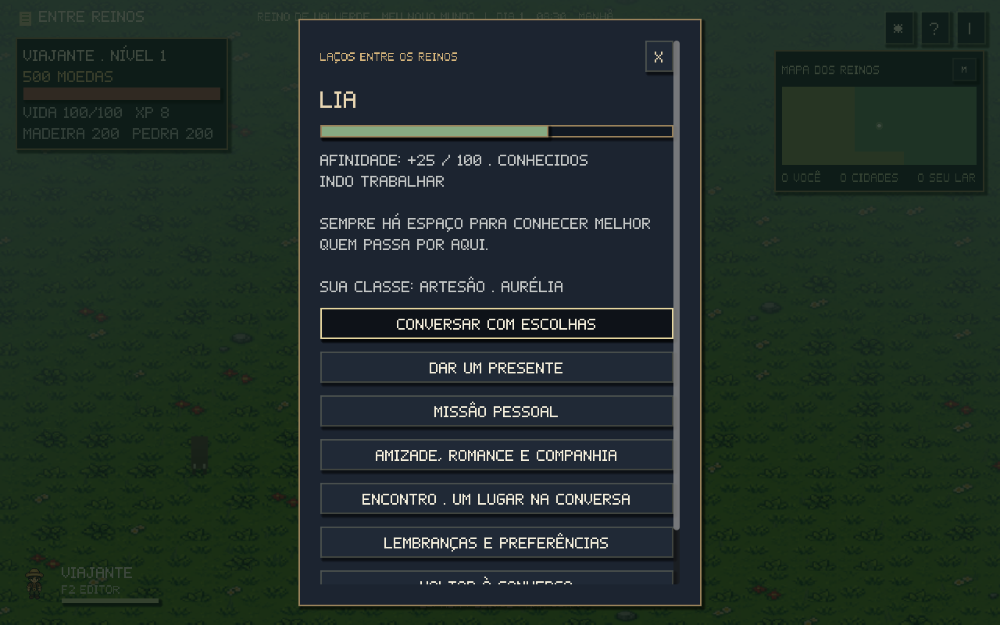
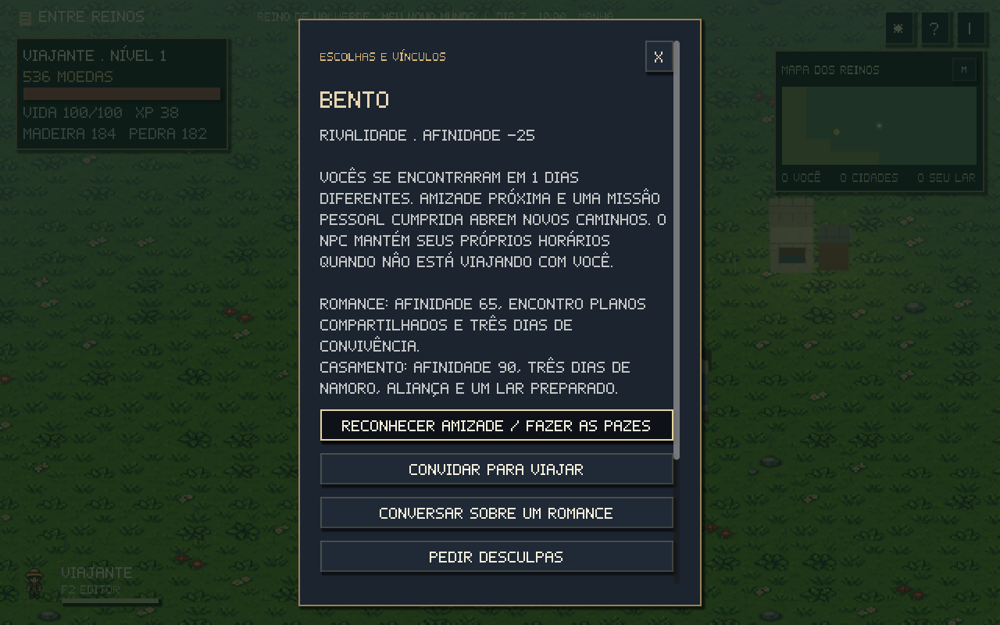
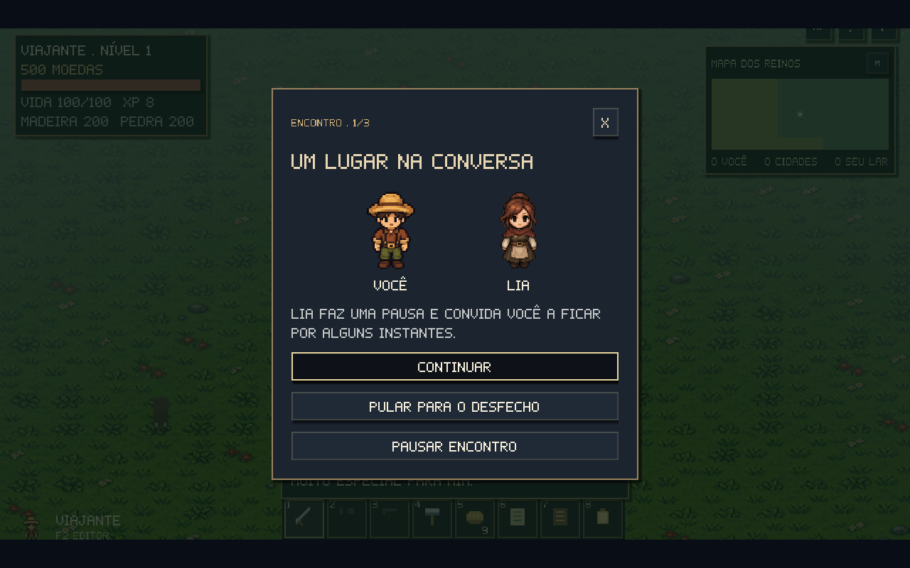
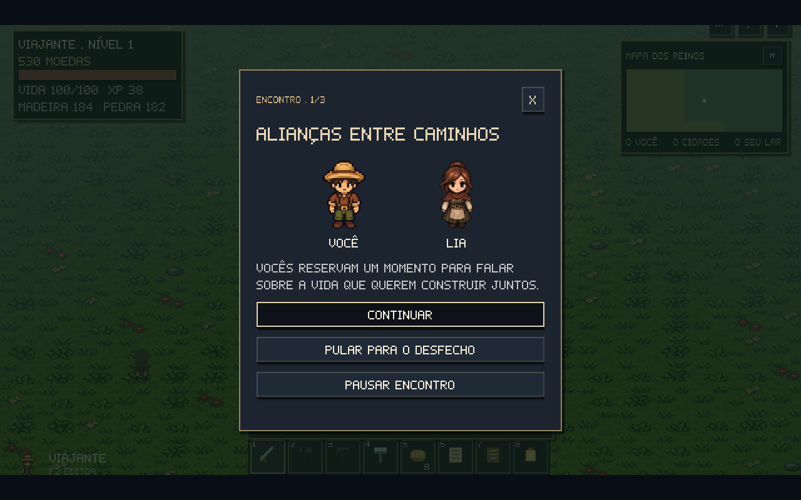
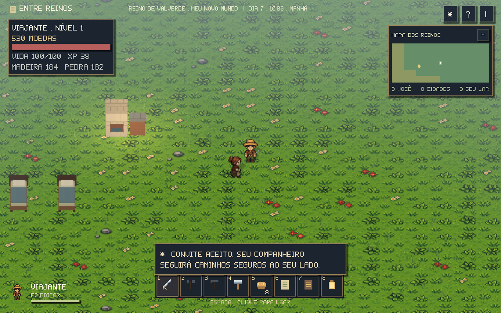

# NPCs e relacionamentos

Use **E** perto de um NPC e escolha **Conversar e relacionamentos**. O painel mostra afinidade, vínculo, atividade atual e a reação às suas ações. Em **J → Relações, missões e identidade**, acompanhe pessoas conhecidas, compromissos, classe, facção e reputação.

## Afinidade e presentes

Cada NPC guarda afinidade própria entre **-100 e +100**. Uma resposta acolhedora pode dar **+3**, uma resposta hostil reduz a confiança, e concluir uma missão pessoal dá **+15**. A conversa positiva do dia só conta uma vez; falas especiais de classe ou facção também têm limites para impedir repetição de recompensas.

Cada morador tem itens que **ama, gosta, considera neutros ou odeia**. As preferências variam por pessoa e ofício. Você pode perguntar sobre gostos ou descobri-los ao presentear. As descobertas ficam em **Lembranças e preferências**.

| Presente | Afinidade |
| --- | ---: |
| Ama | +12 |
| Gosta | +6 |
| Neutro | +1 |
| Odeia | -10 |

São permitidos **dois presentes por NPC a cada dia do jogo**. Cada presente consome uma unidade real da bolsa, que é recebida pelo NPC. Provisões, carne, madeira, pedra, cobre, ferro, tábuas, blocos e lingotes podem ser oferecidos. Faltando o item ou esgotado o limite, o jogo não cobra nem concede afinidade.

## Escolhas, classe e facção

**Conversar com escolhas** oferece respostas com requisitos de afinidade, classe, facção e experiências anteriores. Opções bloqueadas mostram o requisito. Suas respostas podem alterar afinidade, reputação, experiência e lembranças, além de abrir novos assuntos ou missões.

As classes de diálogo são **Viajante, Artesão, Guardião e Explorador**. A primeira escolha é gratuita; reaprender custa 25 moedas. Você pode seguir **Aurélia**, **Valverde** ou permanecer **sem bandeira**, mudando de bandeira uma vez por dia. A reputação de cada reino continua guardada depois da mudança.

## Rotinas que continuam acontecendo

Os 44 moradores da base têm horários e locais de despertar, trabalho, almoço, encontro na taverna e sono. Lenhadores alternam pontos de coleta; a comerciante viaja entre os reinos; o guarda patrulha a travessia; reis recebem moradores e também deixam o castelo para seus encontros.

Refeições usam provisões ou moedas da própria carteira do NPC. O turno de almoço fica salvo para não cobrar a mesma refeição outra vez ao carregar. Trabalho e sono também respeitam camas e estações designadas nas construções do jogador.

## Memórias e consequências

Cada pessoa mantém um registro de presentes, conversas, ajuda, promessas, roubo, reparação e vínculos. **Lembranças e preferências** mostra os acontecimentos recentes; memórias importantes continuam influenciando as respostas mesmo depois de saírem dessa lista.

Tentar roubar transfere seis moedas da carteira do NPC e é percebido: **-25 afinidade, -4 reputação e uma dívida**. O morador recusa novas demonstrações de confiança enquanto espera a devolução. Devolver restitui exatamente as moedas e recupera parte da afinidade; as memórias do roubo e da reparação permanecem. Desculpas também precisam de tempo e atitudes futuras.

## Missões pessoais e encontros

A partir de **15 de afinidade**, pergunte por um plano pessoal. Cada ofício tem pedidos próprios: restaurar uma oficina, preparar uma carroça, reforçar uma casa, guardar mapas, ajudar viajantes ou afastar um javali. Os oito moradores principais têm títulos, pedidos e histórias próprios.

Materiais só são entregues ao concluir a missão, e a recompensa é paga uma vez. Missões de combate contam javalis afastados **depois** de aceitar. Desistir reduz afinidade e deixa a lembrança de uma promessa quebrada; o pedido pode ser retomado a partir de outro dia, recuperada a confiança necessária.

| Encontro | Requisito |
| --- | --- |
| Um lugar na conversa | Afinidade 25 |
| Planos compartilhados | Afinidade 60, primeiro encontro e missão pessoal concluídos |
| Uma conversa difícil | Afinidade -25 ou menos |

Os encontros usam câmera próxima, retratos em pixel art e páginas de diálogo. **Continuar** avança; **Pular para o desfecho** conclui; **Pausar encontro** ou **Esc** guarda a página para retomar depois. O encontro concluído fica registrado e não repete bônus.

## Amizade, rivalidade e romance

Em **Amizade, romance e companhia**, você pode reconhecer uma amizade a partir de **30 de afinidade**, declarar rivalidade ou conversar sobre um romance. Fazer as pazes exige reconstruir a afinidade e reparar dívidas. Rivalidade muda a reação do NPC e impede romance e companhia até a reconciliação.

Romance está disponível para **NPCs adultos** com pelo menos **65 de afinidade**, encontro **Planos compartilhados**, missão pessoal cumprida e convivência em **três dias diferentes**. O NPC responde ao convite. Há um parceiro romântico de cada vez; encerrar o relacionamento preserva as memórias.

## Casamento e vida em casa

Para casar, tenha **90 de afinidade**, pelo menos **três dias de namoro**, uma **aliança** e um lar preparado: casa completa por etapas ou duas camas adequadas para vocês.

A receita **Forjar aliança** fica na forja: **2 lingotes de cobre + 1 lingote de ferro**, em **30 minutos do jogo**. A aliança é consumida ao concluir a cerimônia. Iniciar ou pausar a cena não cobra o item antes do desfecho.

Depois da cerimônia, uma cama livre é designada ao cônjuge quando houver espaço; a casa completa do jogador também pode se tornar o lar compartilhado. O NPC mantém trabalho, refeições e descanso. A cama designada aparece no sistema de construção. Encerrar o relacionamento libera uma cama reservada automaticamente e mantém designações anteriores feitas pelo jogador.

## Companheiro de viagem

Com **60 de afinidade**, o encontro **Planos compartilhados** e confiança sem dívidas, convide um NPC para viajar. Pode ser um amigo ou seu parceiro. Há **um companheiro por vez**.

Ele suspende o próprio trabalho, segue rotas navegáveis, caminha ou corre para acompanhar você e evita obstáculos. Ao nadar, você será esperado na margem. Caravanas e resgates levam a companhia junto. O NPC usa suas próprias provisões ou moedas para se alimentar; precisando de recursos, volta à rotina. Uma relação muito abalada também interrompe a companhia.

**Dispensar companheiro** no diário retoma a rotina sem teletransportá-lo. Ao descansar, o grupo recupera suas necessidades.

## Save e dados do projeto

Afinidade, preferências descobertas, lembranças, missões, escolhas já usadas, classe, facção, reputação, namoro, casamento, companhia e páginas de encontros ficam no save de cada mapa. Construções e vínculos retornam ao voltar para um mapa anterior. Saves antigos mantêm o progresso existente e começam com relações ainda não desenvolvidas.

No projeto Godot, **`game/data/relationships.json`** reúne gostos, histórias, pedidos, cenas e nós de diálogo. Cada escolha pode ter `conditions`, `effects`, `next`, `action` e limites de uso. O motor verifica novamente os requisitos antes de aplicar efeitos. A aliança integra as receitas em **`game/data/construction.json`**. Reexporte os executáveis depois de editar os dados.
