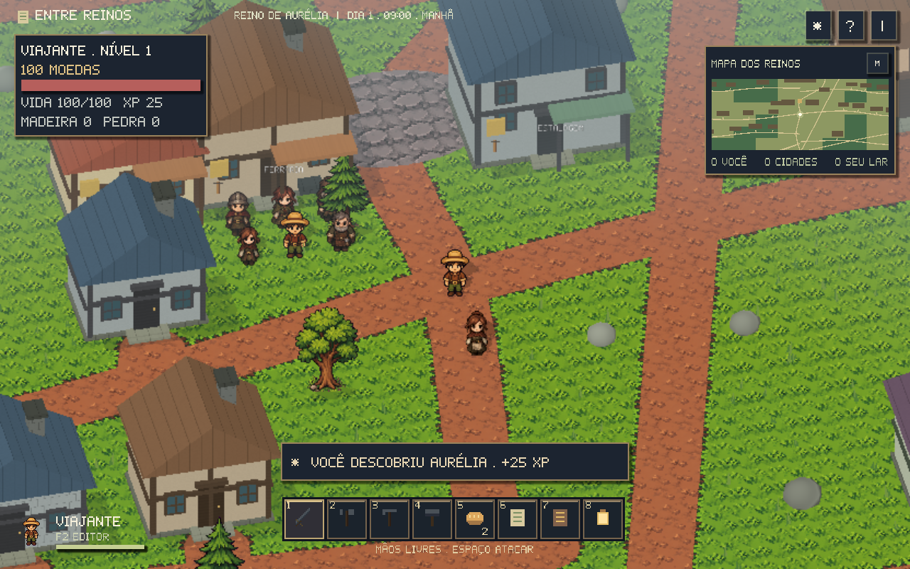
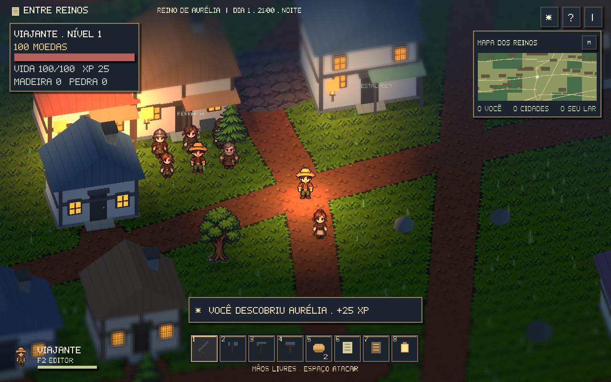
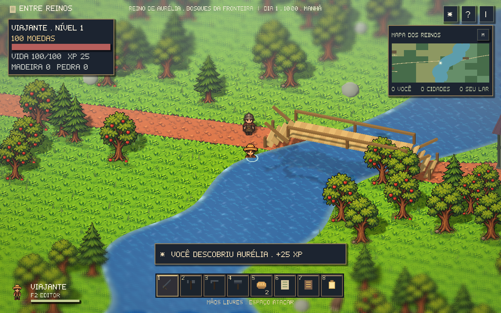
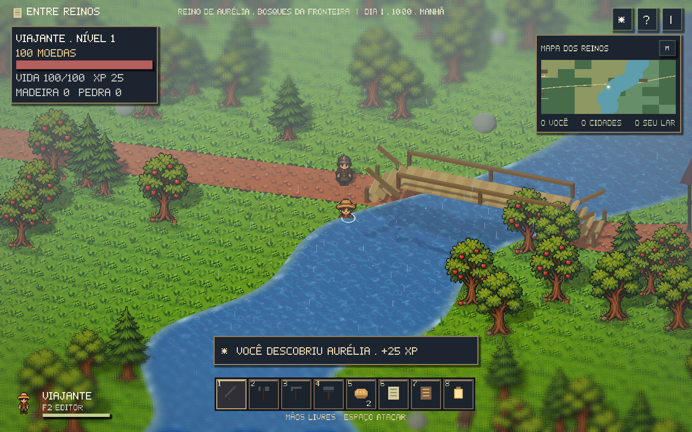

# Visual HD-2D, câmera e clima

O jogo mistura personagens em pixel art com terreno e construções em 3D.
Os sprites acompanham a câmera preservando largura, altura e posição dos pés.
Sombras baseadas nas silhuetas são projetadas no chão; o modo HD-2D também
ativa sombras do sol. A interface permanece nítida em ambos os modos.

| Controle durante a aventura | Ação |
| --- | --- |
| Q / R | Girar à esquerda / direita |
| Botão do meio + arrastar | Girar com o mouse |
| Ctrl + roda, PgUp / PgDn | Aproximar / afastar |
| Home | Restaurar o enquadramento |
| Roda sem Ctrl | Selecionar item da hotbar |

O giro para em 35° para cada lado e o zoom tem limites. A transição é suave;
WASD continua movendo o personagem nas direções da tela. Casas e árvores
que encobrem o jogador deixam uma região transparente para mantê-lo visível.
O editor F2 conserva seus próprios controles de navegação.

Em **Esc → Gráficos**, escolha:

- **Leve:** cenário em resolução reduzida, sombras de silhueta no chão,
  chuva com menos partículas e reflexos menores. É o padrão.
- **HD-2D:** resolução integral, sombras do sol, bloom nas áreas luminosas
  e blur por faixa de foco. A região do personagem permanece nítida,
  enquanto primeiro plano e fundo recebem desfoque suave.

**Esc → Shaders** desliga os efeitos adicionais. **Esc → Clima** permite
usar o ciclo automático ou fixar céu limpo, chuva, neblina ou ventania.
Câmera e escolha de clima ficam no save; no modo automático, os dias e
horários determinam as condições de forma reproduzível.

As nuvens reduzem a luz solar, chuva produz gotas e respingos, neblina altera
a visibilidade e o vento move copas e tufos de grama. A grama também se
curva ao redor do jogador e volta à posição quando ele passa.

Ao anoitecer, janelas iluminam e tochas têm chama animada e luz oscilante.
A lanterna da hotbar continua iluminando o personagem e o chão. A água
mistura reflexo do céu, captura planar da geometria próxima, pequenas ondas
e marcas de chuva. A captura usa resolução reduzida e ignora a própria água;
ela só é atualizada quando há água próxima da câmera.

